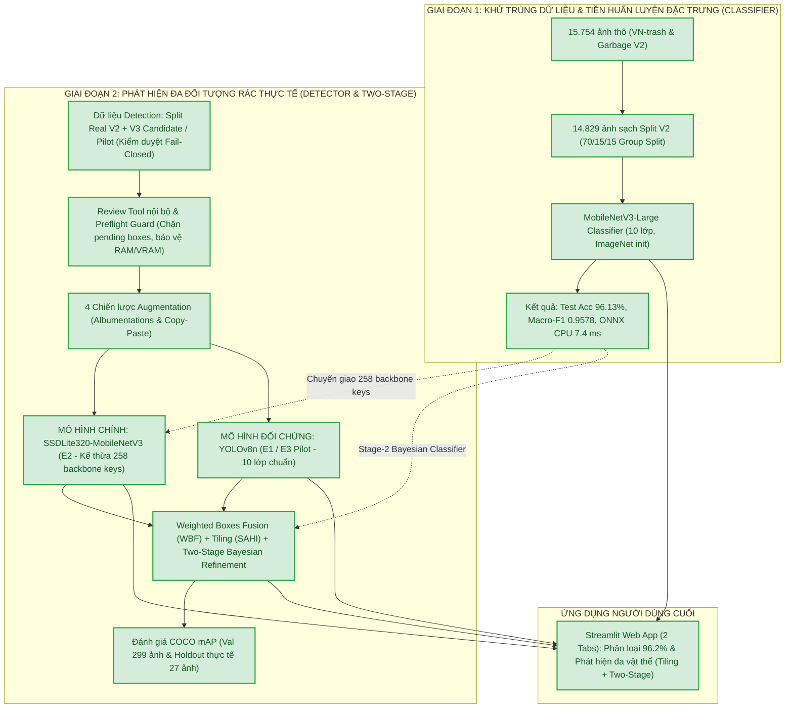

# HƯỚNG DẪN KIẾN TRÚC HỆ THỐNG VÀ LỘ TRÌNH TRIỂN KHAI TIẾP THEO
## DỰ ÁN KHÓA LUẬN TỐT NGHIỆP: CNTT-KLCN155

> **Tên đề tài chính thức:** *Xây dựng hệ thống phát hiện và phân loại đa đối tượng rác thải sinh hoạt trong ảnh chụp thực tế bằng mô hình học sâu nhẹ và kỹ thuật tăng cường dữ liệu*  
> **Cơ sở đào tạo:** Khoa Công nghệ Thông tin – Trường Đại học Công Thương TP.HCM (HUIT)  
> **Giảng viên hướng dẫn:** ThS. Huỳnh Thị Châu Lan (`lanhtc@huit.edu.vn`)  
> **Nhóm sinh viên thực hiện:**
> - Ngô Thanh Nhân (MSSV: 2001230595 — Nhóm trưởng / PM)
> - Võ Gia Ninh (MSSV: 2001230547)
> - Vũ Trường Vinh (MSSV: 2001231049)  
> **Mã nguồn:** [https://github.com/Nhan-create/CNTT-KLCN155-waste-detection](https://github.com/Nhan-create/CNTT-KLCN155-waste-detection)

---

## 1. TỔNG QUAN BÀI TOÁN VÀ BỐI CẢNH HỌC THUẬT

### 1.1. Phạm vi và Mục tiêu nghiên cứu
Hầu hết các nghiên cứu phân loại rác thải trước đây trên hai bộ dữ liệu phổ biến (`VN-trash` và `Garbage Classification V2`) chỉ giải quyết bài toán **Phân loại ảnh đơn nhãn (Single-Object Classification)** trên nền ảnh studio sạch sẽ, một vật thể đơn lẻ. Khi đưa vào bối cảnh thực tế (thùng rác công cộng, vỉa hè, căn tin trường học), các mô hình này bị sụt giảm nghiêm trọng độ chính xác do rác bị biến dạng, dính bẩn, che khuất và nằm chồng lấn nhiều loại rác trong cùng một khuôn hình.

Đề tài **`CNTT-KLCN155`** được thiết kế để giải quyết trọn vẹn bài toán **Phát hiện đa đối tượng (Multi-Object Detection)** trên ảnh tĩnh chụp thực tế:
- **Đầu vào:** Ảnh chụp rác thải thực tế có thể chứa đồng thời nhiều vật thể thuộc các chủng loại khác nhau.
- **Đầu ra hệ thống:**
  1. Tọa độ khung bao (Bounding Box: $x_1, y_1, x_2, y_2$) định vị chính xác từng vật thể rác.
  2. Tên nhãn lớp và độ tin cậy (Confidence score) của từng vật thể.
  3. Bảng thống kê số lượng vật thể theo từng nhóm rác.
  4. Hướng dẫn phân loại nguồn và quy định màu thùng rác tương ứng.
- **Phạm vi loại trừ:** Đề tài không thực hiện phân đoạn biên mặt nạ (Instance Segmentation), không điều khiển cánh tay robot và không xử lý luồng video camera thời gian thực tốc độ cao.

---

## 2. KIẾN TRÚC HỆ THỐNG HAI GIAI ĐOẠN (TWO-STAGE ARCHITECTURE)

Hệ thống được phát triển theo quy trình khoa học hai giai đoạn có tính kế thừa chặt chẽ:



### 2.1. Giai đoạn 1 — Tiền xử lý dữ liệu và Huấn luyện Classifier (ĐÃ HOÀN THÀNH)
- **Mục đích:** Xử lý triệt để bài toán rò rỉ dữ liệu nguồn, loại bỏ bản sao và huấn luyện mô hình tích chập nhẹ MobileNetV3-Large trên tập dữ liệu phân loại đơn rác lớn để tạo bộ trích xuất đặc trưng (feature extractor) chất lượng cao.
- **Kết quả đo đạc thực tế:**
  - Tổng số ảnh sạch: **14.829 ảnh** (loại bỏ 24.518 ảnh sao chép resize, 890 cặp trùng lặp liên nguồn MD5/pHash, và cách ly các mẫu xung đột nhãn).
  - Phân chia Split V2 chống rò rỉ (Atomic Group Split, seed 42): Train 10.383 ảnh (70,02%), Val 2.223 ảnh (14,99%), Test 2.223 ảnh (14,99% — **LOCKED**).
  - Hiệu năng trên tập Test độc lập: **Top-1 Accuracy đạt 96.13% – 96.18%**, **Macro-F1 đạt 0.9578**, Recall lớp pin nguy hại (`battery`) đạt **95.58%**.
  - Tối ưu hóa triển khai: Mô hình xuất sang định dạng ONNX FP32 đạt độ trễ suy luận **7.40 ms/ảnh** trên CPU laptop 6 luồng.

### 2.2. Giai đoạn 2 — Phát hiện đa đối tượng, Tiling, Two-Stage và Hợp nhất dự đoán (ĐÃ TRIỂN KHAI TRONG CODE)
- **Mô hình chính (Primary Model):** **SSDLite320-MobileNetV3 (`E2_ssdlite320_10cls`)**
  - Kế thừa 258/308 tensor keys đặc trưng từ backbone MobileNetV3 đã huấn luyện ở Giai đoạn 1 (Background = 0, Foreground = 1..10).
  - Tối ưu hóa cho thiết bị biên với kích thước ảnh đầu vào $320 \times 320$, độ phức tạp tính toán thấp.
- **Mô hình đối chứng (Benchmark Model):** **YOLOv8n (`E1_yolov8n_10cls` & `E3_yolov8n_pilot`)**
  - Kiến trúc một giai đoạn (Single-stage anchor-free detector) 10 lớp (`0..9`), đóng vai trò mốc đối chứng về độ chính xác và tốc độ.
- **Pipeline Hậu xử lý Đa tầng (`src/web/detection_logic.py`):**
  - **Cắt ô ảnh (`src/detection/tiling.py`):** Tự động chia ảnh lớn ($\ge 800\text{px}$) thành lưới ô $640 \times 640$ có chồng lấp để phát hiện rác nhỏ và lọc bỏ các khung bao nhiễu tràn ô.
  - **Thẩm định hai giai đoạn (`src/detection/two_stage.py`):** Kết hợp điểm của Detector (Stage 1) với xác suất phân loại của `MobileNetV3-Large` (Stage 2) theo công thức nhân xác suất Bayesian (`product`, `min_proposal_gate=0.28`) nhằm loại bỏ triệt để dương tính giả trên nền đường phố, biển hiệu và tủ điện.
  - **Chuẩn hóa tọa độ (`src/detection/coordinates.py`):** Đảm bảo xoay EXIF, đệm tỉ lệ letterbox và chiếu ngược tọa độ chính xác về kích thước ảnh gốc.
- **Kỹ thuật tăng cường dữ liệu mở rộng (`src/detection/augmentation.py` & `src/detection/copy_paste.py`):**
  - Cài đặt đầy đủ 4 chế độ (`none`, `geometric`, `photometric`, `combined`) với **Albumentations** và **Copy-Paste Augmentation**.
- **Kỹ thuật hợp nhất dự đoán Weighted Boxes Fusion (`src/detection/fusion.py`):**
  - Kết hợp bounding box từ SSDLite320 và YOLOv8n theo từng lớp rác, tính trọng số tọa độ dựa trên độ tin cậy đã chọn lọc trên tập Validation.

---

## 3. HỆ THỐNG MƯỜI NHÓM RÁC THỐNG NHẤT (TAXONOMY 10 CLASSES)

Nhóm nghiên cứu và PM đã thống nhất chuẩn hóa **10 nhóm rác chi tiết** xuyên suốt cả Giai đoạn 1 và Giai đoạn 2:

| Class ID | Tên tiếng Anh | Tên tiếng Việt | Đặc điểm nhận dạng thực tế | Loại thùng rác đề xuất |
|:---:|:---|:---|:---|:---|
| **0** | `battery` | Pin nguy hại | Pin tiểu, pin cúc áo, ắc quy nhỏ | **Thùng Đỏ / Nguy hại** |
| **1** | `biological` | Rác hữu cơ | Vỏ trái cây, thức ăn thừa, lá cây | **Thùng Xanh lá / Hữu cơ** |
| **2** | `cardboard` | Bìa carton | Thùng carton sóng, vỏ hộp giấy cứng | **Thùng Vàng / Tái chế** |
| **3** | `clothes` | Vải / Quần áo cũ | Quần áo phế thải, giẻ lau, vải vụn | **Thùng Tái chế vải** |
| **4** | `glass` | Thủy tinh | Chai lọ thủy tinh, ly vỡ, bóng đèn | **Thùng Trắng / Tái chế** |
| **5** | `metal` | Kim loại | Vỏ lon bia/nước ngọt, nắp kim loại, đinh sắt | **Thùng Vàng / Tái chế** |
| **6** | `paper` | Giấy | Giấy vụn, hóa đơn, giấy báo, ly giấy | **Thùng Vàng / Tái chế** |
| **7** | `plastic` | Nhựa | Chai PET, túi ni lông, hộp xốp, cốc nhựa | **Thùng Vàng / Tái chế** |
| **8** | `shoes` | Giày dép phế thải | Giày cũ, dép xốp rách, quai hậu hỏng | **Thùng Tái chế / Khác** |
| **9** | `trash` | Rác vô cơ còn lại | Rác hỗn hợp không thể tái chế, tã lót | **Thùng Xám / Vô cơ** |

---

## 4. BẢNG HIỆN TRẠNG MÃ NGUỒN VÀ TÀI NGUYÊN (INVENTORY AUDIT)

| Hạng mục | Đường dẫn mã nguồn / Artifact | Trạng thái hiện tại |
|:---|:---|:---:|
| **Dữ liệu sạch Classification** | `data/processed_v2/` và `data/audit/split_manifest_v2.csv` | **VERIFIED (14.829 ảnh)** |
| **Trọng số Classifier chính thức** | `artifacts/official_run/best_model.pt` | **VERIFIED (Acc 96.18%)** |
| **Dịch vụ Classifier Web / Stage-2** | `src/web/classifier_service.py` | **VERIFIED** |
| **Công cụ gán nhãn Review Tool** | `src/ui/review_tool.py` | **VERIFIED (Có chặn box pending)** |
| **Cổng kiểm duyệt Dataset & Phần cứng** | `src/detection/safe_dataset_builder.py` & `src/detection/preflight_guard.py` | **VERIFIED (Fail-closed)** |
| **Code & Checkpoint SSDLite320 (E2)** | `src/detection/ssdlite_train.py` & `artifacts/detection_v2/E2_ssdlite320_10cls/` | **VERIFIED (10 lớp, +1/-1 shift)** |
| **Code & Checkpoint YOLOv8n (E1/E3)** | `src/detection/yolo.py` & `artifacts/detection_v2/E1_yolov8n_10cls/` | **VERIFIED (10 lớp chuẩn)** |
| **Tiling, Two-Stage & Coordinates** | `src/detection/tiling.py`, `src/detection/two_stage.py`, `src/detection/coordinates.py` | **VERIFIED** |
| **Augmentation & Copy-Paste** | `src/detection/augmentation.py` & `src/detection/copy_paste.py` | **VERIFIED (4 chiến lược)** |
| **Thuật toán WBF & Grid Search** | `src/detection/fusion.py` & `src/detection/tune.py` | **VERIFIED** |
| **Đánh giá COCO mAP & Thực địa** | `src/detection/evaluate.py` & `reports/qa_acceptance/practical_metrics.py` | **VERIFIED** |
| **Giao diện Web Streamlit (2 Tabs)** | `streamlit_app.py`, `src/web/detection_logic.py`, `src/detection/visualization.py` | **VERIFIED (Hoàn chỉnh)** |

---

## 5. HƯỚNG DẪN CÀI ĐẶT VÀ VẬN HÀNH CỤC BỘ

### 5.1. Khởi tạo môi trường ảo Python
```powershell
# Tạo và kích hoạt môi trường ảo tại thư mục gốc của repo
python -m venv .venv
.\.venv\Scripts\Activate.ps1

# Cài đặt hoặc cập nhật thư viện phụ thuộc
pip install -r requirements.txt
```

### 5.2. Khởi chạy Ứng dụng Web Streamlit
```powershell
# Chạy giao diện Web chính thức
streamlit run streamlit_app.py
```
- Mở trình duyệt tại: `http://localhost:8501`
- Tính năng:
  - **Tab 1:** Phân loại rác độ chính xác cao bằng `MobileNetV3-Large` (96.18%).
  - **Tab 2:** Phát hiện vị trí đa vật thể (`yolov8n`, `ssdlite`, `wbf`), tùy chọn bật/tắt **Tiling**, **Two-Stage Bayesian Refinement (`product` / `blend`)**, **Ngưỡng hiệu chuẩn riêng từng lớp**, chọn kiểu hiển thị khung bao (`Highlight Box` / `Bounding Box`) và tải kết quả đơn hoặc file `.zip` tổng hợp.

### 5.3. Khởi chạy Công cụ Thẩm định Nhãn nội bộ (Review Tool)
```powershell
streamlit run src/ui/review_tool.py -- --manifest data/audit/real_detection_source_manifest.csv
```
- Tính năng: Kiểm tra trực quan từng ảnh và từng bounding box, gán nhãn lại, chuyển trạng thái `APPROVED` / `REJECTED`, tích hợp cơ chế chặn lưu phê duyệt nếu còn bounding box nghi vấn ở trạng thái `PENDING`.

---

## 6. LỘ TRÌNH CÁC BƯỚC ĐÃ TRIỂN KHAI & TIẾP THEO (ACTION PLAN)

### Bước 1: Thống nhất đề cương 10 lớp với GVHD — **ĐÃ HOÀN THÀNH**
- Đã lập tờ trình và báo cáo đối chiếu tại `docs/plan/PROPOSAL_ARCHITECTURE_ALIGNMENT_REVIEW.md` và `docs/proposal/TO_TRINH_XIN_DIEU_CHINH_DE_CUONG_10_LOP.md`.

### Bước 2: Đồng bộ Taxonomy 10 lớp trong toàn bộ Mã nguồn Detection — **ĐÃ HOÀN THÀNH**
- Toàn bộ `src/detection/schema.py`, `dataset.py`, `ssdlite.py`, `yolo.py`, `fusion.py`, `evaluate.py` và `streamlit_app.py` đã khóa cứng 10 lớp chuẩn và vượt qua toàn bộ bộ kiểm thử `pytest`.

### Bước 3: Mở rộng & Kiểm định Dữ liệu Đa đối tượng Thực tế (Task 4 ➔ Task 8) — **ĐANG MỞ RỘNG QUY MÔ**
- Đã thiết lập cổng kiểm duyệt `fail-closed` (`src/detection/safe_dataset_builder.py`), kiểm tra pHash/SHA-256 chống rò rỉ với tập Test (299 ảnh) và tập Holdout thực tế (27 ảnh, 57 GT boxes).

### Bước 4: Lập trình Module Augmentation, Tiling & Two-Stage — **ĐÃ HOÀN THÀNH**
- Đã hoàn thiện `src/detection/augmentation.py`, `src/detection/copy_paste.py`, `src/detection/tiling.py`, `src/detection/two_stage.py`, và `src/detection/coordinates.py`.

### Bước 5: Huấn luyện Baseline E1 (`YOLOv8n`), E2 (`SSDLite320`) & E3 Pilot — **ĐÃ HOÀN THÀNH**
- Đã huấn luyện và kiểm định thực nghiệm `E1_yolov8n_10cls`, `E2_ssdlite320_10cls` (nạp 258 backbone keys từ `MobileNetV3-Large`) và `E3_yolov8n_pilot` (chi tiết tại `docs/BAO_CAO_TONG_HOP_AUDIT_VA_NANG_CAP_MO_HINH_KLCN155.md`).

### Bước 6: Tối ưu hóa Weighted Boxes Fusion (WBF) và Đánh giá Ablation
- **Hành động:**
  - Chạy script `src/detection/tune.py` thực hiện Grid Search tìm bộ trọng số $w_{\text{SSD}}, w_{\text{YOLO}}$ và ngưỡng IoU tối ưu trên tập Validation.
  - Mở khóa tập Test độc lập (chỉ chạy duy nhất 1 lần) để đánh giá đối sánh công bằng: SSDLite vs YOLOv8n vs WBF Ensemble.
  - Đánh giá phân tách trên các nhóm điều kiện ảnh khó: thiếu sáng, ngược sáng, vật thể nhỏ, che khuất, chồng lấn.
  - Đo đạc thông lượng suy luận: Latency batch size 1 (ms), FPS, dung lượng mô hình (MB), mức tiêu thụ RAM/VRAM.
- **Tiêu chí nghiệm thu:** Bảng tổng hợp số liệu ablation đầy đủ đưa vào Chương 4 của Báo cáo khóa luận.

### Bước 7: Đóng gói Bàn giao, Hoàn thiện Báo cáo và Thiết kế Slide Bảo vệ
- **Hành động:**
  - Tích hợp weights tốt nhất vào ứng dụng Web Streamlit.
  - Viết toàn bộ Quyển báo cáo khóa luận theo chuẩn định dạng trường HUIT.
  - Thiết kế bài thuyết trình Slide PowerPoint báo cáo tốt nghiệp.
  - Rà soát mã nguồn, cấu hình, requirements và đẩy phiên bản phát hành cuối cùng lên GitHub.

---

## 7. LIÊN HỆ VÀ ĐÓNG GÓP

Dự án được quản lý tại kho lưu trữ GitHub chính thức:  
👉 **[https://github.com/Nhan-create/CNTT-KLCN155-waste-detection](https://github.com/Nhan-create/CNTT-KLCN155-waste-detection)**

Mọi phản hồi kỹ thuật xin liên hệ Nhóm trưởng: **Ngô Thanh Nhân** (Email: `nhan.create@gmail.com`).
