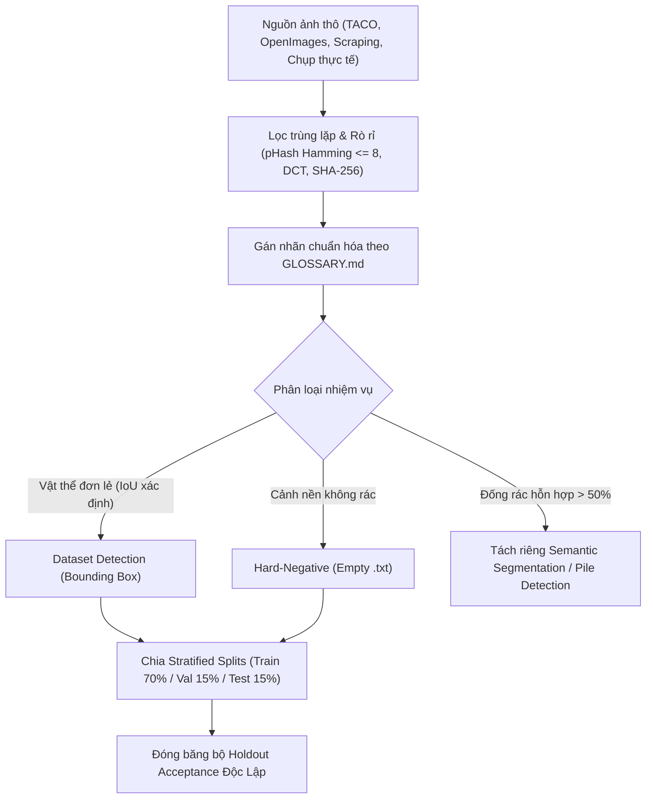

# ĐẶC TẢ KỸ THUẬT: CHUẨN HÓA VÀ NÂNG CẤP BỘ DỮ LIỆU PHÁT HIỆN RÁC THẢI (CNTT-KLCN155)
> Spec-Driven Data Architecture: Chấm dứt hiện tượng đói nhãn, loại bỏ False Positive cảnh nền và chuẩn hóa Ground Truth.

---

## 1. MỤC TIÊU VÀ PHẠM VI (OBJECTIVES & SCOPE)

### 1.1. Hiện trạng và điểm nghẽn
1. **Mất cân bằng dữ liệu cực đoan (Class Starvation)**:
   - Trong tập huấn luyện `splits_real_v2/train.txt` (1398 ảnh, 3963 box):
     - `battery` chỉ có **1 box** duy nhất (0.03%).
     - `biological` chỉ có **3 box** (0.08%).
     - Trong khi `plastic` chiếm 1560 box (39.36%) và `trash` chiếm 854 box (21.55%).
   - Hậu quả: Mô hình không thể học được đặc trưng của pin và rác hữu cơ; nhận diện nhầm pin laptop thành `shoes` (confidence 0.92) hoặc `metal` (0.88).
2. **Thiếu hoàn toàn ảnh Negative (Zero Background Images)**:
   - Toàn bộ 1398 ảnh train đều chứa ít nhất 1 box rác. Không có bất kỳ ảnh cảnh nền rỗng nào (`empty label`).
   - Hậu quả: Detector kích hoạt False Positive trên tường gạch, biển hiệu, tủ kỹ thuật và vỉa hè vì nó chưa từng được học cảnh nền không có rác.
3. **Dị thường cấu trúc trong Ground Truth Holdout v1 (`data/holdout`)**:
   - 7 box chiếm đúng 100% diện tích ảnh (full canvas fill).
   - 12 box chiếm $\ge 80\%$ diện tích ảnh.
   - 2 ảnh thùng rác công cộng và giỏ rác văn phòng bị gán nhãn thành rác `plastic` cần thu gom.
   - Thảm kính vỡ và đống quần áo khổng lồ chiếm toàn cảnh khiến phép đo mAP của mô hình Object Detection bị sai lệch.

### 1.2. Mục tiêu kỹ thuật (Target Specs)
- **Tập Train v3**: Tối thiểu 500 ảnh/class cho các class yếu (`battery`, `biological`, `cardboard`, `paper`).
- **Tập Negative**: Tích hợp 200 - 300 ảnh Hard-Negative (tường, tủ điện, vỉa hè, biển hiệu, thùng rác rỗng) chiếm 10% - 15% tổng số ảnh train.
- **Ground Truth Holdout v2**: Chuẩn hóa 45 vật thể hữu hiệu (Active Objects), tách biệt đống rác cận cảnh và cách ly thùng rác công cộng.

---

## 2. NGUYÊN TẮC THIẾT KẾ DỮ LIỆU (DATA ENGINEERING PRINCIPLES)



### 2.1. Cấu trúc thư mục dữ liệu chuẩn
```
data/detection/
├── images/
│   ├── real/
│   │   ├── taco/
│   │   ├── openimages/
│   │   ├── supplemental_battery/
│   │   ├── supplemental_biological/
│   │   └── hard_negatives/
├── labels/
│   ├── real/
│   │   ├── ... (các file .txt tương ứng)
│   │   └── hard_negatives/ (.txt rỗng 0 bytes)
├── splits_real_v3/
│   ├── train.txt
│   ├── val.txt
│   └── test.txt
└── configs/
    └── detection_dataset_real_v3.yaml
```

---

## 3. TIÊU CHÍ NGHIỆM THU DỮ LIỆU (DATA DEFINITION OF DONE - DoD)

1. **Không rò rỉ (Zero Data Leakage)**: Khoảng cách Hamming pHash giữa bất kỳ ảnh nào giữa Train, Val, Test và Holdout phải $> 8$.
2. **Cân bằng tối thiểu (Minimum Representation)**: Mỗi class trong 10 class phải có ít nhất 100 boxes trong tập Train, không class nào dưới 50 boxes.
3. **Hiện diện Negative (Negative Presence)**: Tỷ lệ ảnh negative trong tập train nằm trong khoảng $10.0\% \le \text{ratio} \le 15.0\%$.
4. **Độc lập Holdout**: Bộ Holdout Acceptance được bảo quản read-only với mã hash SHA-256 cố định, không tham gia vào bất kỳ vòng train/val nào.
