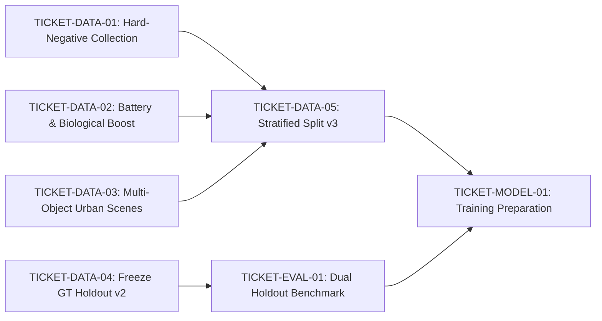

# DANH SÁCH TICKETS THỰC THI NÂNG CẤP DỮ LIỆU (CNTT-KLCN155)
> Phân rã công việc kỹ thuật chi tiết theo thứ tự phụ thuộc, tiêu chí hoàn thành và người phụ trách.

---

## TỔNG QUAN LỘ TRÌNH TRIỂN KHAI

---

### TICKET-DATA-01: Thu thập và chuẩn hóa tập ảnh Hard-Negative (Cảnh nền không rác)
- **Mã vé**: `DATA-01`
- **Chuyên trách**: Agent A (Data / Mapping)
- **Mức độ ưu tiên**: P0 (Bắt buộc trước khi train)
- **Mô tả công việc**:
  1. Thu thập tối thiểu 250 ảnh cảnh nền độ phân giải cao tại Việt Nam hoàn toàn không chứa rác:
     - 60 ảnh tường gạch, mặt đá hoa cương, mặt tiền tòa nhà, biển quảng cáo.
     - 60 ảnh tủ điện màu xanh, trạm biến áp, hộp kỹ thuật ven đường.
     - 60 ảnh vỉa hè lát gạch sạch, bậc tam cấp, lòng đường nhựa.
     - 40 ảnh thùng rác công cộng sạch, giỏ rác văn phòng rỗng (để triệt tiêu lỗi nhận nhầm thùng rác).
     - 30 ảnh sàn nhà, bàn ghế, nội thất trong nhà.
  2. Tạo các file label `.txt` rỗng (kích thước 0 bytes) tương ứng trong `data/detection/labels/real/hard_negatives/`.
  3. Kiểm tra tính toàn vẹn và không trùng lặp bằng pHash.
- **Tiêu chí nghiệm thu (DoD)**:
  - Tối thiểu 250 ảnh JPEG/PNG hợp lệ.
  - 100% file nhãn là file rỗng 0 bytes.
  - Chạy thử qua pipeline nạp dataset của PyTorch/Ultralytics không bị lỗi crash do nhãn rỗng.

---

### TICKET-DATA-02: Bổ sung dữ liệu xóa đói nhãn cho `battery` và `biological`
- **Mã vé**: `DATA-02`
- **Chuyên trách**: Agent A (Data / Mapping)
- **Mức độ ưu tiên**: P0 (Bắt buộc trước khi train)
- **Mô tả công việc**:
  1. Hiện tại tập train chỉ có **1 box pin** và **3 box hữu cơ**. Cần bổ sung khẩn cấp:
     - Tối thiểu 200 ảnh pin thực tế (pin AA, AAA, pin vuông 9V, pin cúc áo, cell 18650, pin sạc dự phòng, ắc quy cũ).
     - Tối thiểu 200 ảnh rác hữu cơ đơn lẻ hoặc cụm nhỏ (vỏ chuối, cuống rau, quả hỏng, bã cà phê, vỏ trứng).
  2. Gán nhãn thủ công bounding box chặt chẽ (tight bounding box) theo tọa độ YOLO chuẩn `[class_id x_center y_center width height]`.
  3. Đảm bảo nhãn `battery` là Class 0 và `biological` là Class 1.
- **Tiêu chí nghiệm thu (DoD)**:
  - Tối thiểu 300 boxes mới cho `battery` và 300 boxes mới cho `biological`.
  - Không có box nào chiếm $\ge 80\%$ diện tích ảnh (tránh lặp lại lỗi full canvas).
  - Tỷ lệ IoU gán nhãn đạt chuẩn QA nội bộ $\ge 0.90$.

---

### TICKET-DATA-03: Bổ sung ảnh thực tế nhiều vật thể (Multi-Object Urban Scenes)
- **Mã vé**: `DATA-03`
- **Chuyên trách**: Agent A (Data / Mapping)
- **Mức độ ưu tiên**: P1 (Quan trọng)
- **Mô tả công việc**:
  1. Bổ sung 150 ảnh chụp thực tế bối cảnh đường phố Việt Nam có từ 3 đến 10 vật thể rác nằm rải rác:
     - Chai nhựa, cốc trà sữa dưới chân cột đèn/gốc cây.
     - Vỏ lon bia, hộp sữa, đầu lọc thuốc lá trên vỉa hè.
     - Giấy ăn, túi bóng vụn ven lề đường.
  2. Gán nhãn từng vật thể đơn lẻ, tuyệt đối không gán 1 box lớn bao trùm toàn bộ cụm rác.
- **Tiêu chí nghiệm thu (DoD)**:
  - Số lượng box trung bình trên mỗi ảnh đạt từ 4.0 đến 8.0 boxes/ảnh.
  - Độ phủ đa dạng điều kiện ánh sáng (nắng gắt, bóng râm, chạng vạng).

---

### TICKET-DATA-04: Đóng băng Holdout v1 và Khởi tạo Holdout v2 Standardized
- **Mã vé**: `DATA-04`
- **Chuyên trách**: Agent D (QA Độc lập)
- **Mức độ ưu tiên**: P0
- **Mô tả công việc**:
  1. Giữ nguyên tệp gốc `reports/qa_acceptance/ground_truth_hinh_anh_rac.json` (v1 - 57 boxes) làm chuẩn đối chiếu lịch sử (Historical Legacy Holdout).
  2. Triển khai tệp `reports/qa_acceptance/ground_truth_hinh_anh_rac_v2_proposed.json` đã chuẩn hóa:
     - Loại bỏ 4 box lỗi nghiêm trọng (100% canvas duplicate `download (2).jpg`, thảm kính `base64...`, thùng rác công cộng `images (18).jpg`, giỏ rác `images (8).jpg`).
     - Tách riêng 8 ảnh đống rác cận cảnh/khổng lồ sang danh mục đánh giá `FLAGGED_UNSEGREGATED_PILE`.
     - Giữ lại 45 vật thể hữu hiệu (Active Objects) cho bài toán Object Detection vật thể đơn lẻ.
  3. Cung cấp bộ ảnh overlay review visual cho PM duyệt nghiệm thu.
- **Tiêu chí nghiệm thu (DoD)**:
  - Tệp v1 không bị sửa đổi bất kỳ byte nào (SHA-256 đối chiếu toàn vẹn).
  - Tệp v2 có đầy đủ metadata, schema và rationale cho từng đối tượng.
  - Script đánh giá hỗ trợ cờ chọn lọc `--gt_version v1|v2`.

---

### TICKET-DATA-05: Phân chia Stratified Split v3 và Quét chống rò rỉ rác
- **Mã vé**: `DATA-05`
- **Chuyên trách**: Agent A (Data / Mapping)
- **Mức độ ưu tiên**: P0
- **Mô tả công việc**:
  1. Tích hợp dữ liệu hiện có (`real_v2`) + dữ liệu bổ sung từ `DATA-01`, `DATA-02`, `DATA-03`.
  2. Chạy thuật toán băm ảnh pHash (64-bit DCT) kiểm tra toàn bộ tập dữ liệu với bộ Holdout 27 ảnh:
     - Ngưỡng Hamming distance $\le 8$ kích hoạt cảnh báo rò rỉ.
     - Loại bỏ ngay lập tức bất kỳ ảnh train/val nào có nguồn gốc trùng hoặc gần trùng với 27 ảnh Holdout.
  3. Phân chia tập theo tỷ lệ:
     - Train: 70%
     - Validation: 15%
     - Test: 15%
     - Đảm bảo phân tầng (Stratified) theo class hiếm nhất (`battery`, `biological`).
  4. Xuất file `configs/detection_dataset_real_v3.yaml`.
- **Tiêu chí nghiệm thu (DoD)**:
  - Báo cáo kiểm toán rò rỉ `leakage_audit_report_v3.json` xác nhận 0 va chạm SHA-256 và 0 rò rỉ pHash với Holdout.
  - File cấu hình YAML hợp lệ, nạp được qua `YoloBoxDataset` và Ultralytics DataLoader.

---

### TICKET-MODEL-01: Thiết lập Protocol huấn luyện chống False Positive
- **Mã vé**: `DATA-06 / MODEL-01`
- **Chuyên trách**: Agent B (Model / Inference)
- **Mức độ ưu tiên**: P1 (Sau khi hoàn tất dữ liệu)
- **Mô tả công việc**:
  1. Cấu hình DataLoader nạp ảnh Hard-Negative (empty labels).
  2. Bật tính năng Class Loss Weighting hoặc Focal Loss ($\gamma = 2.0$) để bù trừ cho tỷ lệ xuất hiện của các class.
  3. Cấu hình data augmentation: Mosaic (giảm prob xuống 0.5 để tránh vỡ box nhỏ), MixUp tắt trong 10 epoch cuối, Copy-Paste tăng cường cho `battery`.
  4. Đặt checkpoint baseline để đối chiếu.
- **Tiêu chí nghiệm thu (DoD)**:
  - Huấn luyện thử nghiệm 1 epoch thành công trên GPU, kiểm tra gradient và loss không bị NaN/Inf.
  - Đăng ký run_id và checksum checkpoint theo đúng quy chuẩn AGENTS.md.
