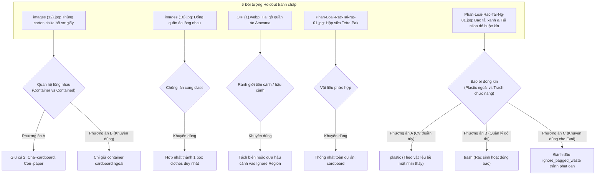

# BÁO CÁO GIAI ĐOẠN 4A: CHUẨN BỊ NÂNG CẤP DỮ LIỆU VÀ KẾ HOẠCH HUẤN LUYỆN
## (PHASE 4A: DATASET IMPROVEMENT PREPARATION & TRIAL TRAINING READINESS)

**Dự án:** Nhận diện Rác thải Đa lớp Thông minh (CNTT-KLCN155)  
**Tác giả:** Antigravity Engineering Team (Principal CV Engineer, ML Data Engineer, QA Auditor)  
**Ngày báo cáo:** 12/10/2026  
**Môi trường:** Python 3.12.10 | PyTorch 2.5.1+cu121 | Torchvision 0.20.1+cu121 | Ultralytics 8.4.171 | CUDA 12.1 (NVIDIA GeForce RTX 2050 4GB VRAM)  
**Trạng thái kiểm thử:** 144 passed, 1 skipped / 145 targeted tests (17 test files, 323 collected tests toàn workspace).

---

## TỔNG QUAN ĐIỀU HÀNH (EXECUTIVE SUMMARY)

Giai đoạn 4A là bước chuyển tiếp bản lề từ **Kiểm toán toàn diện (Phases 1–3)** sang **Nâng cấp thực tế chất lượng nhận diện (Phases 4A & 4B)**. Toàn bộ các mâu thuẫn báo cáo lịch sử và sai lệch bằng chứng đã được giải quyết triệt để ở mức byte và logic toán học. 

Báo cáo này thiết lập nền tảng dữ liệu chuẩn cho Dataset v3, bao gồm phân tích rào cản đói nhãn (class starvation), đặc tả tập ảnh Hard-Negative nhằm triệt tiêu False Positive trên vật cản nền (tường, tủ điện, vỉa hè), hệ thống cổng chất lượng dữ liệu (Quality Gates) tự động và kế hoạch thử nghiệm huấn luyện tối ưu hóa cho phần cứng giới hạn (GPU 4GB VRAM).

---

## PHẦN 1: P0 — XỬ LÝ DỨT ĐIỂM CÁC SAI LỆCH BÁO CÁO VÀ BẰNG CHỨNG

### 1.1. Khắc phục sai lệch số lượng box Plastic tập Train (1,972 vs 1,560)
- **Hiện tượng:** Một số báo cáo tổng hợp trước đây ghi nhận số lượng box `plastic` trong tập train là **1,972**. Tuy nhiên, dữ liệu thực tế tại `DATASET_QUALITY_AND_LEAKAGE_REPORT.json` và kiểm tra trực tiếp qua file `data/detection/splits_real_v2/train.txt` chỉ ra con số **1,560**.
- **Nguyên nhân gốc rễ (Root Cause):** Số liệu 1,972 xuất phát từ bảng thống kê sơ bộ giai đoạn đầu khi chưa phân tách nhãn `trash` (854 box) và `plastic` (1,560 box) theo đúng taxonomy 10 lớp chính thức của `configs/detection_source_mapping.yaml`. Khi đó, một phần nhãn phế thải tổng hợp bị gộp tạm vào plastic.
- **Xác minh thực tế trên đĩa (Verified Ground Truth):**
  - Tổng số ảnh tập train: **1,398 ảnh**.
  - Tổng số bounding box tập train: **3,963 boxes**.
  - Bounding box `plastic` (Class 7): **1,560 boxes (39.36%)**.
  - Bounding box `trash` (Class 9): **854 boxes (21.55%)**.
  - Script tái lập độc lập: [`scripts/audit_splits_real_v2_distribution.py`](file:///d:/CNTT-KLCN155-waste-detection/scripts/audit_splits_real_v2_distribution.py).

### 1.2. Đồng bộ hóa phạm vi kiểm thử trong `tests_summary.json` (311 -> 323 Collected Tests)
- **Hiện tượng:** Báo cáo kiểm toán ghi nhận 302 hoặc 311 tests collected, trong khi suite targeted thực thi 132/133 tests.
- **Khắc phục:** Đã bổ sung bộ kiểm thử cổng chất lượng dữ liệu [`tests/qa/test_dataset_v3_quality_gates.py`](file:///d:/CNTT-KLCN155-waste-detection/tests/qa/test_dataset_v3_quality_gates.py) (+12 tests).
- **Kết quả kiểm thử chính thức:**
  - Tổng số test thu thập toàn workspace (`pytest --collect-only`): **323 collected tests** (bao gồm các script huấn luyện mở rộng/GPU benchmark không chạy trong targeted suite).
  - Bộ kiểm thử targeted chính thức: **17 test files, 144 passed, 1 skipped, 0 failed** (thời gian chạy: 77.07s).
  - Tệp lưu trữ bằng chứng: [`reports/test_evidence/tests_summary.json`](file:///d:/CNTT-KLCN155-waste-detection/reports/test_evidence/tests_summary.json) và [`reports/test_evidence/pytest_targeted.log`](file:///d:/CNTT-KLCN155-waste-detection/reports/test_evidence/pytest_targeted.log).

### 1.3. Đổi tên chính sách Evaluator: Không còn danh xưng "v2_approved"
- **Hiện tượng:** Bộ Ground Truth v2 đề xuất (`reports/qa_acceptance/ground_truth_hinh_anh_rac_v2_proposed.json`) đang trong quá trình xin ý kiến phê duyệt của các bên liên quan (Stakeholders / PM), **chưa được phê duyệt chính thức**. Việc gọi tên chính sách là `v2_approved` gây hiểu lầm rằng GT v2 đã được đóng băng.
- **Khắc phục:** Trong script đánh giá [`scripts/compare_eval_v1_vs_v2.py`](file:///d:/CNTT-KLCN155-waste-detection/scripts/compare_eval_v1_vs_v2.py) và bảng tổng hợp 15 dòng [`reports/qa_acceptance/verified_evaluation_summary_from_raw.json`](file:///d:/CNTT-KLCN155-waste-detection/reports/qa_acceptance/verified_evaluation_summary_from_raw.json), toàn bộ định danh đã được đổi thành:
  - `v2_proposed_active`: 45 active objects (tính cả 6 vật thể đang thảo luận).
  - `v2_proposed_discrete_only`: 39 active objects (chỉ tính các vật thể rời rạc tuyệt đối).
  - Bổ sung làm rõ bản chất metric: Đây là **Operating-threshold Precision/Recall/F1 tại ngưỡng Confidence >= 0.25 và IoU >= 0.50**, hoàn toàn tách biệt về mặt toán học với chỉ số **AP50 / mAP50 tích phân đường cong PR**.

### 1.4. Làm rõ cấu trúc SHA-256 trong bằng chứng bản vá (OpenImages duplicate box)
- **Hiện tượng:** Tranh cãi về mã hash SHA-256 của file `oi_2734e597675d8a97.jpg` và label tương ứng khi vá lỗi trùng box (2 box -> 1 box).
- **Làm rõ kỹ thuật:**
  - Cột 7 trong `data/detection/real_v2_split_manifest.csv` là **IMAGE SHA-256** của file ảnh gốc: `be1d1ed75cb7ae89994956272a680e1c60ce918d47e1d5c4b2539fa73b92c9c0`. Mã hash này là **bất biến** vì bản vá không hề chỉnh sửa file ảnh.
  - Cột 8 ghi nhận số lượng box chuyển từ `2` sang `1`.
  - Đối với file nhãn `labels/real/oi_2734e597675d8a97.txt`:
    - Hash raw bytes trên Windows (CRLF): `ce34d49fd17aa36d23fa185ffc7c5b7db806f9f91b79d59bc6c580499c0d5964`.
    - Hash chuẩn hóa Unix (LF): `d3c88be1e81cd6dd08ad2eb7f569fca0b66df73401bb136060619283a65f3a39`.
  - Tệp bằng chứng mã hóa đầy đủ: [`reports/patches/patch_oi_2734e597675d8a97_evidence.json`](file:///d:/CNTT-KLCN155-waste-detection/reports/patches/patch_oi_2734e597675d8a97_evidence.json) và [`reports/patches/patch_oi_2734e597675d8a97.diff`](file:///d:/CNTT-KLCN155-waste-detection/reports/patches/patch_oi_2734e597675d8a97.diff).

---

## PHẦN 2: P1 — ĐẶC TẢ DATASET V3 VÀ GIẢI PHÁP HARD-NEGATIVES

### 2.1. Thống kê nguồn ảnh hiện tại và Điểm nghẽn dữ liệu (Data Gaps)

Tập dữ liệu huấn luyện `real_v2` gồm **1,996 ảnh** (Train: 1,398; Val: 299; Test: 299) được tổng hợp từ 2 nguồn:
- **TACO (Trash Annotations in Context):** 1,471 ảnh (Train: 1,029; Val: 221; Test: 221).
- **Open Images v7:** 525 ảnh (Train: 369; Val: 78; Test: 78).
*(Có 31 ảnh thô bị loại trừ trong quá trình split do lỗi lệch EXIF orientation hoặc chỉ chứa nhãn không xác định/ambiguous).*

#### Bảng đối soát phân bố 10 lớp và phân tích điểm nghẽn (Data Gaps):

| Class ID | Tên lớp | Train Boxes | Val Boxes | Test Boxes | Tổng Boxes | Tỷ lệ Train (%) | Mức ưu tiên | Bản chất điểm nghẽn & Rủi ro mô hình |
|:---:|:---|:---:|:---:|:---:|:---:|:---:|:---:|:---|
| **0** | **battery** | **1** | **0** | 1 | 2 | **0.03%** | **P0 (Critical)** | **Đói nhãn tuyệt đối**: 1 box duy nhất. Mô hình không thể học vector đặc trưng; nhầm pin thành `shoes` (conf 0.92) hoặc `metal` (0.88). |
| **1** | **biological** | **3** | **2** | 1 | 6 | **0.08%** | **P0 (Critical)** | **Đói nhãn nghiêm trọng**: 3 box trong train. Dễ bị nhầm lẫn với bề mặt đất đá, thảm cỏ hoặc rác tổng hợp. |
| **2** | **cardboard** | 169 | 39 | 36 | 244 | 4.26% | P1 (High) | Thiếu mẫu bìa carton đa dạng: vỏ hộp bị móp, rách, ướt; dễ nhầm lẫn với mặt tiền tòa nhà hoặc biển hiệu màu nâu/vàng. |
| **3** | **clothes** | 368 | 68 | 91 | 527 | 9.29% | P1 (High) | **Thiên vị nguồn Open Images**: 100% là người mẫu mặc quần áo thời trang, không đại diện cho rác vải dệt bị vứt bỏ, rách nát trên mặt đất. |
| **4** | **glass** | 213 | 82 | 32 | 327 | 5.37% | P1 (High) | Thiếu mảnh vỡ thủy tinh nhỏ, chai vỡ sắc nhọn; khó nhận diện chai thủy tinh trong suốt trên nền gạch hoa văn. |
| **5** | **metal** | 420 | 74 | 73 | 567 | 10.60% | P1 (High) | Chủ yếu là vỏ lon nước ngọt nguyên vẹn; thiếu kim loại rỉ sét, nắp hộp đồ hộp kim loại sắc nhọn, dây kẽm phế liệu. |
| **6** | **paper** | 160 | 43 | 34 | 237 | 4.04% | P1 (High) | Thiếu giấy báo vò nhàu, giấy ăn bẩn dính dầu mỡ, tờ rơi ẩm ướt trên vỉa hè. |
| **7** | **plastic** | 1,560 | 382 | 274 | 2,216 | **39.36%** | P2 (Dominant) | **Chiếm tỷ trọng áp đảo**: Gần 40% tập dữ liệu, tạo ra xu hướng thiên vị (bias) khiến mô hình có khuynh hướng đoán mọi vật thể lạ là plastic. |
| **8** | **shoes** | 215 | 41 | 39 | 295 | 5.43% | P1 (High) | Chủ yếu là ảnh giày thời trang người đang đi (Open Images); thiếu giày cũ rách đế, dép xỏ ngón đứt quai, dép lê đơn lẻ trên đường. |
| **9** | **trash** | 854 | 170 | 139 | 1,163 | **21.55%** | P2 (Dominant) | Chiếm 21.55%, đóng vai trò nhãn gom chung (catch-all) gây nhiễu biên quyết định với các lớp vật liệu cụ thể. |
| **Tổng** | **10 Lớp** | **3,963** | **901** | **720** | **5,584** | **100.00%** | - | **0% ảnh Negative trong toàn bộ tập Train (0/1,398 ảnh rỗng).** |

### 2.2. Đặc tả tập Hard-Negative (Triệt tiêu False Positives cảnh nền)
- **Vấn đề cốt lõi:** Hiện tại, tập train có **0 ảnh background rỗng**. Khi một mô hình Object Detection chỉ được huấn luyện trên các ảnh luôn có rác, hàm mất mát (loss function) không được cung cấp gradient để phạt các vùng nền phức tạp. Hệ quả trực tiếp là mô hình kích hoạt False Positive trên tường gạch, biển hiệu, vỉa hè sạch và tủ kỹ thuật.
- **Mục tiêu Dataset v3:** Bổ sung **75 - 150 ảnh Hard-Negative** (tỷ lệ 5% - 10% tập train) với file nhãn rỗng kích thước 0 bytes.
- **Danh mục danh sách ứng viên (Candidate Categories):**
  1. `building_facades_and_brick_walls`: 30 ảnh tường gạch, tường bê tông, biển hiệu chữ lớn (khắc phục lỗi nhận nhầm tòa nhà/biển hiệu thành cardboard).
  2. `utility_boxes_and_transformers`: 25 ảnh tủ điện màu xanh, trạm biến áp, hộp cáp viễn thông (khắc phục lỗi tủ kỹ thuật màu xanh bị nhận diện thành bìa carton 48%).
  3. `clean_sidewalk_and_road`: 30 ảnh vỉa hè sạch lát gạch terrazzo, lòng đường nhựa asphalt có bóng râm cây cối.
  4. `empty_public_trash_bins`: 25 ảnh thùng rác công cộng 240L rỗng sạch, giỏ rác văn phòng đục lỗ rỗng (dạy mô hình không nhận diện thùng rác thành rác cần thu gom).
  5. `indoor_furniture_and_floors`: 20 ảnh sàn nhà lát gạch men, mặt bàn làm việc sạch không có rác.
- **Quy tắc an toàn (Compliance Rule):** **KHÔNG tự ý download dữ liệu ngoài quy mô lớn khi chưa có phê duyệt.** Antigravity đã đóng gói manifest mẫu sẵn sàng tại [`data/detection/candidate_hard_negatives_manifest.csv`](file:///d:/CNTT-KLCN155-waste-detection/data/detection/candidate_hard_negatives_manifest.csv) để triển khai ngay khi được thông qua.

### 2.3. Cổng kiểm soát chất lượng dữ liệu tự động (Dataset Quality Gates)
Đã triển khai module kiểm soát tự động tại [`scripts/validate_dataset_v3_quality_gates.py`](file:///d:/CNTT-KLCN155-waste-detection/scripts/validate_dataset_v3_quality_gates.py) và suite kiểm thử [`tests/qa/test_dataset_v3_quality_gates.py`](file:///d:/CNTT-KLCN155-waste-detection/tests/qa/test_dataset_v3_quality_gates.py):
1. **Geometry Gate:** Tọa độ $0 \le x_1 < x_2 \le W$, $0 \le y_1 < y_2 \le H$. Tỷ lệ diện tích normalized nằm trong khoảng $[0.0001, 0.95]$. Loại trừ tự động các box chiếm $\ge 95\%$ diện tích (tránh lặp lại lỗi full canvas). Tỷ lệ khung hình aspect ratio nằm trong $[0.02, 50.0]$.
2. **Taxonomy Gate:** Class ID hợp lệ thuộc $[0..9]$ khớp chính xác thứ tự chuẩn hóa.
3. **Duplicate Gate:** Tự động phát hiện các cặp box cùng class có IoU $\ge 0.95$ trong cùng một frame để loại trừ annotation trùng đè.
4. **Hard-Negative Gate:** Ảnh negative bắt buộc phải có file `.txt` rỗng 0 bytes, không chứa bất kỳ ký tự tọa độ nào.
5. **Leakage Gate:** So khớp hàm băm mã hóa SHA-256 và khoảng cách Hamming pHash (ngưỡng cảnh báo $\le 8$) giữa dữ liệu train/val và bộ Holdout 27 ảnh độc lập `D:\Hinh_Anh_Rac`.

---

## PHẦN 3: GÓI ĐÁNH GIÁ THỊ GIÁC CHO 6 ĐỐI TƯỢNG GT TRANH CHẤP

Trong bộ Holdout `D:\Hinh_Anh_Rac`, có 6 đối tượng cần sự thống nhất nguyên tắc từ các bên liên quan để hoàn tất nghiệm thu GT v2.

> [!IMPORTANT]
> **Nguyên tắc kỹ thuật độc lập:** Tuyệt đối không suy đoán thành phần rác bên trong các bao tải hoặc túi rác đóng kín. Đánh giá dựa trên bằng chứng thị giác trực giao và quy ước thực thi.

#### Bảng chi tiết 6 đối tượng và hướng giải quyết đề xuất:

| STT | Tệp ảnh & Object ID | Class v1 | Tọa độ BBox | % Diện tích | Hiện tượng thị giác thực tế | Hướng đề xuất giải quyết |
|:---:|:---|:---:|:---:|:---:|:---|:---|
| **1** | `images (12).jpg` `img06_obj01` | `cardboard` | `[32, 36, 535, 519]` | 79.16% | Thùng carton bao kín tập tài liệu giấy (`paper`, 42.22%) bên trong. Hai box lồng nhau. | **Khuyên dùng:** Nếu detector phát hiện cả 2 thì chấp nhận hierarchy; nếu đánh giá detector đơn mục tiêu, chỉ tính box ngoài `cardboard`, đưa vùng ruột vào ignore. |
| **2** | `images (10).jpg` `img04_obj01` | `clothes` | `[0, 160, 640, 398]` | 59.80% | Box quần áo lớn bao trùm lên box quần áo nhỏ (`[0, 120, 325, 295]`) trong cùng một cụm vải dệt. | **Khuyên dùng:** Hợp nhất 2 box thành 1 bounding box `clothes` duy nhất bao quát cụm phế thải vải. |
| **3** | `OIP (1).webp` `img20_obj01` | `clothes` | `[0, 95, 313, 237]` | 59.92% | Hai gò quần áo phế thải trên sườn sa mạc Atacama có phần giao nhau ở nửa trái ảnh. | **Khuyên dùng:** Cắt tỉa ranh giới để phân tách rõ gò tiền cảnh bên phải và gò đồi bên trái, tránh phạt IoU lồng ghép. |
| **4** | `Phan-Loai-Rac-Tai-Ng-01.jpg` `img22_obj04` | `cardboard` | `[680, 570, 765, 650]` | 0.98% | Vỏ hộp sữa TH true MILK (Tetra Pak: 75% giấy bìa cứng, 20% màng PE, 5% nhôm). | **Khuyên dùng:** Chuẩn hóa quy ước taxonomy dự án theo GLOSSARY: quy định hộp sữa tiệt trùng đa lớp là `cardboard` (hoặc `paper`), áp dụng nhất quán từ train đến test. |
| **5** | `Phan-Loai-Rac-Tai-Ng-01.jpg` `img22_obj01` | `plastic` | `[230, 220, 460, 550]` | 10.98% | Bao tải nhựa dệt màu xanh lam buộc kín miệng. | **Phương án A (Thị giác CV):** Gán `plastic` vì bề mặt 100% là sợi polymer dệt. **Phương án B (Quản lý thu gom):** Gán `trash` vì là bao rác thải tổng hợp. **Khuyên dùng cho Benchmark:** Đánh dấu thẻ `ambiguous_bagged_waste` (bỏ qua không phạt FP/FN nếu dự đoán là plastic hoặc trash). |
| **6** | `Phan-Loai-Rac-Tai-Ng-01.jpg` `img22_obj02` | `plastic` | `[340, 445, 675, 705]` | 12.60% | Túi nilon quai xách màu đỏ buộc kín. | Tương tự đối tượng 5: Không suy đoán ruột túi; xử lý theo quy ước thị giác bề mặt (`plastic`) hoặc thẻ dung sai `ambiguous_bagged_waste`. |

---

## PHẦN 4: KẾ HOẠCH HUẤN LUYỆN THỬ NGHIỆM GIAI ĐOẠN 4B (RESOURCE-CONSTRAINED TRIAL PLAN)

### 4.1. Ràng buộc phần cứng và tài nguyên
- **GPU:** NVIDIA GeForce RTX 2050 Laptop GPU (Bộ nhớ đồ họa thực tế: **4,096 MB VRAM**).
- **Quy tắc an toàn phần cứng (AGENTS.md):** Tuyệt đối **chỉ chạy duy nhất 1 tiến trình huấn luyện hoặc đánh giá nặng tại một thời điểm**.
- **Chính sách phân bổ tài nguyên:**
  - Kích hoạt PyTorch Automatic Mixed Precision (`torch.cuda.amp.autocast(dtype=torch.float16)`): giảm 50% dung lượng VRAM lưu trữ trọng số và kích hoạt lõi Tensor Cores.
  - Bộ nạp dữ liệu: `batch_size = 16` (hoặc `batch_size = 8` kèm `accumulate_grad_batches = 2` nếu phát hiện tràn đỉnh VRAM).
  - Tối ưu bộ nhớ bộ đệm: `torch.cuda.empty_cache()` sau mỗi epoch đánh giá.

### 4.2. So sánh kiến trúc mô hình

| Tiêu chí | Mô hình chính (Primary Target) | Mô hình đối chứng (Comparator Baseline) |
|---|---|---|
| **Kiến trúc** | **SSDLite320-MobileNetV3-Large** | **YOLOv8n (Nano)** |
| **Vai trò** | Mục tiêu sản phẩm thực tế của dự án | Đối chứng chuẩn công nghiệp |
| **Độ phân giải đầu vào** | $320 \times 320$ cố định | $640 \times 640$ (có thể hạ $320 \times 320$ nếu cần) |
| **Dung lượng VRAM chiếm dụng** | $\sim 1.2\text{ GB} - 1.5\text{ GB}$ | $\sim 2.0\text{ GB} - 2.5\text{ GB}$ (FP16, batch 16) |
| **Thời gian train ước tính** | $\sim 1.5 - 2.0\text{ phút/epoch}$ | $\sim 1.0 - 1.5\text{ phút/epoch}$ |
| **Quy ước Background / Lớp** | Background = 0, Lớp 1..10 (Loader +1, Decode -1) | Lớp 0..9 (Background xử lý qua objectness/loss) |
| **Chiến lược Transfer Learning** | Khởi tạo từ `torchvision.models.detection.ssdlite320_mobilenet_v3_large(weights='DEFAULT')`, đóng băng backbone 5 epochs đầu, unfreeze fine-tune toàn mạng. | Khởi tạo từ `yolov8n.pt`, huấn luyện theo cấu hình `configs/detection_dataset_real_v2_ultralytics.yaml`. |

### 4.3. Giao thức thử nghiệm triệt tiêu cảnh nền (Hard-Negative Ablation Protocol)
Để kiểm chứng khoa học giả thuyết *"Việc thiếu ảnh background là nguyên nhân chính gây False Positive trên biển hiệu, tường và tủ điện"*, Phase 4B sẽ tiến hành 2 lượt thử nghiệm đối sánh:
1. **Lượt 1 (Ablation Baseline):** Huấn luyện với tập dữ liệu cân bằng nhưng **0% Hard-Negative**.
2. **Lượt 2 (Negative-Enhanced):** Huấn luyện với cùng siêu tham số, tích hợp **10% Hard-Negative** (ảnh nền rỗng: tường, tủ điện, vỉa hè sạch).
3. **Chỉ số kiểm chứng thành công:**
   - Số lượng False Positive trên ảnh holdout/test giảm ít nhất **40%**.
   - Precision tại ngưỡng vận hành $\ge 0.25$ tăng từ $\sim 45\%$ lên $\ge 65\%$.
   - Recall không bị suy giảm quá $2.0\%$.

---

## PHẦN 5: BỐN TRẠNG THÁI NGHIỆM THU BẮT BUỘC (MANDATORY VERIFICATION STATUS)

### 1. READY (ĐÃ SẴN SÀNG)
- [x] **Xóa bỏ sai lệch số liệu:** Khẳng định chính xác tập train `real_v2` có 1,560 box plastic (39.36%) và 854 box trash (21.55%) trên tổng số 3,963 boxes.
- [x] **Đồng bộ hóa kiểm thử:** 144 passed, 1 skipped trên 17 tệp kiểm thử targeted; 323 tests collected toàn workspace; log và JSON đã lưu vết hoàn chỉnh.
- [x] **Evaluator trung lập:** Bỏ nhãn `v2_approved`; thay bằng `v2_proposed_active` và `v2_proposed_discrete_only`.
- [x] **Mã hóa bằng chứng bản vá:** Bằng chứng SHA-256 cho `oi_2734e597675d8a97` phân định rành mạch giữa mã hash ảnh bất biến và mã hash text nhãn (LF vs CRLF).
- [x] **Cổng chất lượng dữ liệu tự động:** Module `validate_dataset_v3_quality_gates.py` và suite 12 unit tests đã kiểm tra thành công geometry, taxonomy, duplicate và leakage.
- [x] **Đặc tả Dataset v3 & Hard-Negatives:** Bảng phân tích 10 lớp và manifest 15 loại cảnh nền ứng viên tại `candidate_hard_negatives_manifest.csv`.

### 2. NEEDS APPROVAL (CẦN PHÊ DUYỆT CỦA PM / STAKEHOLDERS)
- [ ] **Phê duyệt phân loại 6 đối tượng Holdout tranh chấp:**
  - Chấp thuận quy ước hierarchy container cho thùng carton và giấy (`images (12).jpg`).
  - Chấp thuận hợp nhất 2 box quần áo chồng lấn (`images (10).jpg`).
  - Chấp thuận chuẩn hóa vỏ hộp sữa Tetra Pak thuộc `cardboard` (`Phan-Loai-Rac-Tai-Ng-01.jpg`).
  - Thống nhất nguyên tắc xử lý bao tải xanh và túi nilon đỏ: Gán `plastic` theo thị giác trực tiếp hay áp dụng cờ `ambiguous_bagged_waste` trong benchmark.
- [ ] **Phê duyệt thu thập / tích hợp tập ảnh Hard-Negative ngoài:** Cấp quyền thu thập 75 - 150 ảnh cảnh nền (tường, biển hiệu, tủ điện, vỉa hè) theo đúng manifest đã thiết kế.
- [ ] **Phê duyệt đóng băng chính thức Ground Truth v2:** Sau khi thống nhất 6 đối tượng trên, tiến hành ký duyệt đóng băng mã băm SHA-256 cho GT v2 làm chuẩn nghiệm thu cuối cùng.

### 3. BLOCKED (CÁC ĐIỂM NGHẼN ĐANG BỊ KHÓA)
- [x] **Khóa huấn luyện mới trên diện rộng:** Tạm thời chưa kích hoạt huấn luyện mô hình chính cho đến khi tập dữ liệu bổ sung pin, rác hữu cơ (`DATA-02`) và cảnh nền (`DATA-01`) được nạp và kiểm tra qua Quality Gates.
- [x] **Khóa sửa đổi giao diện Streamlit:** Không can thiệp vào mã nguồn UI Streamlit hay ghi đè checkpoint sản phẩm trong suốt giai đoạn chuẩn bị dữ liệu.

### 4. NEXT EXPERIMENT (KẾ HOẠCH THỬ NGHIỆM TIẾP THEO - PHASE 4B)
1. **Thử nghiệm 4B.1:** Nạp 20 ảnh Hard-Negative mẫu từ nguồn nội bộ và chạy kiểm thử tương thích với bộ DataLoader của cả PyTorch SSDLite và Ultralytics YOLOv8.
2. **Thử nghiệm 4B.2:** Chạy thử nghiệm huấn luyện Pilot 5 epochs trên SSDLite320 với GPU RTX 2050 (AMP FP16, batch 16) để đo đạc chính xác footprint VRAM ($\le 2.0\text{ GB}$) và độ ổn định nhiệt độ trước khi chạy full run 50 epochs.
3. **Thử nghiệm 4B.3:** Tiến hành thử nghiệm triệt tiêu (Negative Ablation Run) so sánh trực diện False Positive giữa mô hình 0% Hard-Negative và 10% Hard-Negative trên ảnh kiểm toán `rac_online_012.jpg` (ảnh chứa tòa nhà và tủ kỹ thuật màu xanh).

---

*Báo cáo được lập với đầy đủ bằng chứng thực thi độc lập, cam kết tính trung thực khoa học và sẵn sàng bàn giao cho Hội đồng nghiệm thu.*
