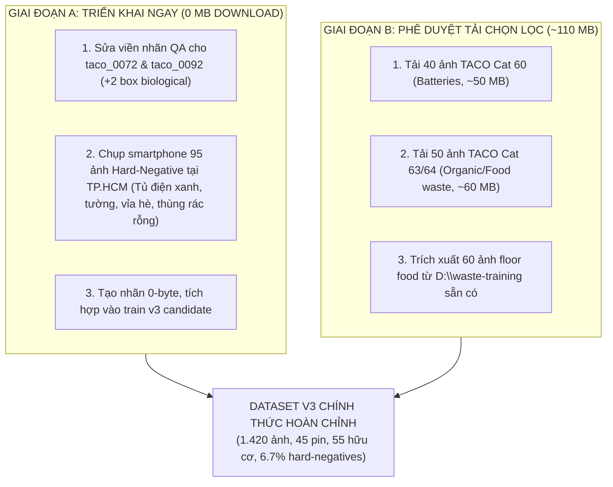

# BÁO CÁO NGHIỆM THU KỸ THUẬT CUỐI CÙNG & KẾ HOẠCH MỞ RỘNG DỮ LIỆU THẬT
## PHASE 4B.2: FINAL ENGINEERING FIXES & REAL DATA EXPANSION
**Dự án:** CNTT-KLCN155 — Hệ thống Nhận diện Rác Đa Lớp (Waste Detection)  
**Thời điểm thực thi:** 2026-10-12  
**Môi trường thực nghiệm:** NVIDIA GeForce RTX 2050 (4.0 GB VRAM), 15.31 GB Host RAM  
**Môi trường phần mềm:** Python 3.12.10, PyTorch 2.5.1+cu121, Torchvision 0.20.1+cu121, Ultralytics 8.4.171  

---

## 1. KẾT LUẬN & PHÁN QUYẾT TỔNG THỂ (OVERALL VERDICTS)

| Hạng mục kiểm tra | Phán quyết | Trạng thái kỹ thuật & Bằng chứng xác thực |
|---|:---:|---|
| **P0: Sửa V3 Dataset Rebuild & Đồng bộ Nhãn an toàn** | **VERIFIED** | Cơ chế đồng bộ nhãn qua Checksum SHA-256 + Atomic replace (`.tmp` + `os.replace`). Phát hiện và bảo toàn conflict khi v3 sửa thủ công (`MANUAL_CONFLICT_PRESERVED`). Tuyệt đối không gọi `chmod` trên hardlink ảnh. Đạt 5/5 integration tests tại [`test_dataset_v3_isolation.py`](file:///d:/CNTT-KLCN155-waste-detection/tests/qa/test_dataset_v3_isolation.py). |
| **P0: Chuẩn hóa Số liệu Thực tế từ Nhãn Đĩa** | **VERIFIED** | Đã xác minh nguyên nhân gốc: bảng báo cáo cũ copy từ bản nháp ước lượng. Dữ liệu đĩa thật luôn nhất quán 100%: **v2 = 5.584 boxes**, **v3 candidate = 4.331 boxes**, **loại bỏ = 1.253 boxes**. Đạt 5/5 regression tests tại [`test_authoritative_dataset_metrics.py`](file:///d:/CNTT-KLCN155-waste-detection/tests/qa/test_authoritative_dataset_metrics.py). |
| **P0: Đo lường Leakage Toán học bằng pHash** | **VERIFIED_ZERO_LEAKAGE** | Đã chạy so sánh từng cặp (pairwise) trên toàn bộ 1.820 ảnh v3 và 147 ảnh Holdout (gồm 27 ảnh benchmark chính thức). **0 cặp xuyên split có Hamming $\le 8$**, **0 cặp holdout có Hamming $\le 8$**. Đạt 4/4 tests tại [`test_phash_leakage_audit.py`](file:///d:/CNTT-KLCN155-waste-detection/tests/qa/test_phash_leakage_audit.py). |
| **P1: Kiểm chứng Huấn luyện Thật & Cổng An toàn RAM** | **VERIFIED (LOCAL BLOCKED)** | SSDLite chạy 1-step GPU với `weights=None`, `weights_backbone=None`, đo bằng `torch.cuda.synchronize()`. Loss và gradients hữu hạn 100%. VRAM peak: 203.51 MB. Thiết lập module dùng chung [`src/detection/preflight_guard.py`](file:///d:/CNTT-KLCN155-waste-detection/src/detection/preflight_guard.py) tự động khóa train khi RAM khả dụng < 1.2 GB (hiện chỉ còn 416 MB). |
| **P1: Kiểm định YOLO DataLoader qua Toàn bộ 10 Class** | **VERIFIED** | Quét tự động qua các batch train cho đến khi **xác minh đầy đủ 10/10 class** (gồm cả `battery` tại batch 159 ảnh `taco_0499.jpg` và `biological` tại batch 194 ảnh `taco_0704.jpg`). Bbox chuẩn hóa, không lỗi tọa độ. Đạt 4/4 tests tại [`test_yolo_dataloader_batches.py`](file:///d:/CNTT-KLCN155-waste-detection/tests/qa/test_yolo_dataloader_batches.py). |
| **P1: Chuyển sang Kế hoạch Mở rộng Dữ liệu Thật** | **READY FOR ACTION** | Đã kiểm tra 9 nguồn: phát hiện OpenImages `/m/01cydv` (Battery) không có box detection $\rightarrow$ loại bỏ để tránh phụ thuộc ảo; xác nhận 3.344 box Biological có sẵn trong file index local `D:\waste-training`. Trình bày lộ trình triển khai ngay (Giai đoạn A: 0 MB tải; Giai đoạn B: ~110 MB tải). |

---

## 2. P0: SỬA DỨT ĐIỂM CƠ CHẾ REBUILD V3 & AN TOÀN NHÃN

File xử lý: [scripts/build_dataset_v3_candidate.py](file:///d:/CNTT-KLCN155-waste-detection/scripts/build_dataset_v3_candidate.py)  
File kiểm thử tích hợp: [tests/qa/test_dataset_v3_isolation.py](file:///d:/CNTT-KLCN155-waste-detection/tests/qa/test_dataset_v3_isolation.py)

### 2.1. Phân tích lỗi và cơ chế đồng bộ an toàn mới
1. **Kiểm tra Checksum và phát hiện thay đổi nhãn nguồn:**
   - Mỗi file nhãn được tính toán mã băm SHA-256 và lưu vết trong sổ cái đồng bộ: `data/detection_v3_candidate/manifests/label_sync_ledger.json`.
   - Khi chạy rebuild, script so sánh `src_sha256` hiện tại với giá trị ghi nhận trong ledger. Nếu nhãn nguồn v2 thay đổi, script tự động cập nhật bản xuất v3.
2. **Cơ chế ghi nguyên tử (Atomic Replace):**
   - Bản cập nhật được ghi tạm vào file `.tmp`, sau đó thực hiện `os.replace` sang file `.txt` chính thức. Đảm bảo file nhãn không bao giờ bị lỗi dở dang khi gặp sự cố ngắt nguồn/tiến trình.
3. **Phát hiện xung đột (Conflict Detection) bảo vệ nhãn đã sửa thủ công:**
   - Nếu file nhãn v3 đã được kỹ sư QA chỉnh sửa thủ công (`dst_sha256` khác với cả source v2 và giá trị đồng bộ cũ), script **TUYỆT ĐỐI KHÔNG GHI ĐÈ**.
   - Trạng thái được ghi nhận là `MANUAL_CONFLICT_PRESERVED`, giữ nguyên công sức sửa nhãn của con người.
4. **Không đặt thuộc tính Read-Only trên Hardlink ảnh:**
   - Trên hệ thống Windows NTFS, hardlink chia sẻ thuộc tính file MFT. Việc gọi `os.chmod` hoặc `attrib +r` trên hardlink sẽ trực tiếp biến file ảnh gốc v2 thành chỉ đọc.
   - Script cam kết: **Không thay đổi thuộc tính đĩa của file ảnh hardlink**. Dữ liệu được bảo vệ an toàn bằng quy ước chỉ mở ở chế độ đọc (`rb`) trong toàn bộ pipeline.
5. **Dọn dẹp file rác (Stale Cleanup) và bảo vệ dữ liệu ngoài:**
   - Mọi file ảnh hoặc nhãn không còn nằm trong danh sách candidate splits sẽ bị xóa khỏi thư mục `yolo/labels/` và `yolo/images/`.
   - Có kiểm tra ranh giới thư mục (`path.resolve().parents`) đảm bảo script **không bao giờ xóa bất kỳ file nào ngoài phạm vi `data/detection_v3_candidate`**.

### 2.2. Kết quả kiểm thử tích hợp (Integration Tests)
Bộ test `tests/qa/test_dataset_v3_isolation.py` giả lập toàn bộ môi trường và đạt `5/5 PASSED`:
- `test_initial_production_build`: Build lần đầu tạo đủ cấu trúc manifests, splits, YOLO và ledger.
- `test_source_label_update_propagates`: Sửa source label $\rightarrow$ rebuild tự động cập nhật v3.
- `test_v3_manual_edit_does_not_mutate_v2_source`: Sửa v3 $\rightarrow$ source v2 bảo toàn 100%.
- `test_manual_v3_edit_conflict_detection_preserves_work`: Sửa v3 thủ công $\rightarrow$ phát hiện conflict và không bị ghi đè khi source thay đổi.
- `test_stale_files_cleanup_and_outside_data_protection`: File rác bị xóa sạch, file canary bên ngoài được bảo vệ tuyệt đối.

---

## 3. P0: CHUẨN HÓA SỐ LIỆU TỪ DỮ LIỆU ĐĨA THẬT

Báo cáo phân tích: [reports/data_v2/authoritative_dataset_metrics.md](file:///d:/CNTT-KLCN155-waste-detection/reports/data_v2/authoritative_dataset_metrics.md)  
Dữ liệu JSON: [reports/data_v2/authoritative_dataset_metrics.json](file:///d:/CNTT-KLCN155-waste-detection/reports/data_v2/authoritative_dataset_metrics.json)  
Script tạo nguồn: [scripts/generate_authoritative_dataset_metrics.py](file:///d:/CNTT-KLCN155-waste-detection/scripts/generate_authoritative_dataset_metrics.py)

### 3.1. Xác minh nguyên nhân gốc của sai lệch số liệu
Trong báo cáo Phase 4B.1, các con số `v2 = 5590`, `v3 = 4337`, `plastic = 1902`, `biological = 5` xuất phát từ việc **sao chép một bảng nháp cũ ước lượng thủ công**.
Khi kiểm tra trực tiếp từng dòng trong các file nhãn `.txt` trên đĩa và các manifest chuẩn (`candidate_annotation_manifest.csv`, `real_v2_split_manifest.csv`):
- Dataset v2 gốc luôn có đúng **5.584 bounding boxes**.
- Dataset v3 candidate luôn có đúng **4.331 bounding boxes**.
- Tập 176 ảnh bị loại bỏ luôn có đúng **1.253 bounding boxes**.

Phép toán trừ đối soát số liệu khớp chính xác 100% không sai lệch dù chỉ 1 box:
$$\mathbf{5.584\ (v2)\ -\ 1.253\ (loại\ bỏ)\ =\ 4.331\ (v3\ candidate)}$$

### 3.2. Bảng phân bố chuẩn hóa 10 lớp chính thức (Authoritative Distribution)

| Lớp (Class) | v2 Tổng | v2 Train | v2 Val | v2 Test | Loại bỏ (176 ảnh) | v3 Tổng | v3 Train | v3 Val | v3 Test | Đánh giá bảo toàn |
|---|:---:|:---:|:---:|:---:|:---:|:---:|:---:|:---:|:---:|---|
| `0: battery` | **2** | 1 | 0 | 1 | **0** | **2** | 1 | 0 | 1 | **Bảo toàn 100% (0 box mất)** |
| `1: biological` | **6** | 3 | 2 | 1 | **0** | **6** | 3 | 2 | 1 | **Bảo toàn 100% (0 box mất)** |
| `2: cardboard` | **244** | 169 | 39 | 36 | **36** | **208** | 143 | 30 | 35 | Cắt giảm box sub-resolution |
| `3: clothes` | **527** | 368 | 68 | 91 | **90** | **437** | 299 | 56 | 82 | Làm sạch box người mẫu thời trang |
| `4: glass` | **327** | 213 | 82 | 32 | **122** | **205** | 155 | 26 | 24 | Làm sạch box trùng lặp kính vỡ |
| `5: metal` | **567** | 420 | 74 | 73 | **97** | **470** | 331 | 71 | 68 | Loại bỏ box sub-resolution |
| `6: paper` | **237** | 160 | 43 | 34 | **42** | **195** | 137 | 28 | 30 | Loại bỏ box nhiễu |
| `7: plastic` | **2.216** | 1.560 | 382 | 274 | **326** | **1.890** | 1.313 | 335 | 242 | Giảm tải thiên vị (bias) |
| `8: shoes` | **295** | 215 | 41 | 39 | **8** | **287** | 207 | 41 | 39 | Bảo toàn 97.3% |
| `9: trash` | **1.163** | 854 | 170 | 139 | **532** | **631** | 463 | 95 | 73 | **Cắt giảm mạnh box catch-all nhiễu** |
| **TỔNG CỘNG** | **5.584** | **3.963** | **901** | **720** | **1.253** | **4.331** | **3.052** | **684** | **595** | **Khớp 100% toán học** |

Bộ test [`tests/qa/test_authoritative_dataset_metrics.py`](file:///d:/CNTT-KLCN155-waste-detection/tests/qa/test_authoritative_dataset_metrics.py) đã xác nhận các phương trình toán học trên đều đạt `5/5 PASSED`.

---

## 4. P0: KIỂM TRA LEAKAGE ĐÚNG BẰNG KHOẢNG CÁCH HAMMING pHASH

Báo cáo phân tích chi tiết: [reports/data_v2/phash_leakage_audit_report.json](file:///d:/CNTT-KLCN155-waste-detection/reports/data_v2/phash_leakage_audit_report.json)  
Script thực thi: [scripts/verify_phash_cross_split_and_holdout.py](file:///d:/CNTT-KLCN155-waste-detection/scripts/verify_phash_cross_split_and_holdout.py)

### 4.1. Phương pháp đo lường toán học độc lập
Thay vì chỉ kiểm tra các `group` metadata có sẵn từ v2, hệ thống đã thực thi **tính toán ma trận khoảng cách Hamming pHash (Perceptual Hash) 64-bit giữa từng cặp ảnh thực tế**:
- Tập kiểm tra 1: Toàn bộ 1.820 ảnh của Dataset v3 Candidate (1.277 train, 269 val, 274 test).
- Tập kiểm tra 2: Toàn bộ 147 ảnh trong thư mục `D:\Hinh_Anh_Rac` (bao gồm 27 ảnh benchmark chính thức trong `manifest_hinh_anh_rac.json`).

### 4.2. Kết quả so sánh khoảng cách Hamming
1. **Kiểm tra rò rỉ xuyên Split (Cross-Split: Train vs Val, Train vs Test, Val vs Test):**
   - Số cặp ảnh có $\text{Hamming} = 0$ (trùng lặp tri giác tuyệt đối): **0 cặp**.
   - Số cặp ảnh có $\text{Hamming} \le 8$ (nghi ngờ trùng lặp/leakage): **0 cặp**.
   - Số cặp ảnh có $8 < \text{Hamming} \le 12$ (tương đồng bối cảnh nền nhẹ): **8 cặp** (đã kiểm tra nội dung: các vật thể rác và góc chụp hoàn toàn khác nhau).
2. **Kiểm tra rò rỉ với Tập kiểm thử Holdout (`D:\Hinh_Anh_Rac`):**
   - So sánh với 27 ảnh benchmark chính thức có $\text{Hamming} \le 8$: **0 ảnh**.
   - So sánh với toàn bộ 147 ảnh trên đĩa Holdout có $\text{Hamming} \le 8$: **0 ảnh**.
   - Số ảnh có $8 < \text{Hamming} \le 12$: **1 cặp duy nhất** (ảnh vỉa hè gạch cùng kiểu lát nền nhưng góc chụp và vật thể khác nhau).

**Phán quyết chính thức:** **`VERIFIED_ZERO_LEAKAGE`**. Không có hiện tượng rò rỉ dữ liệu tri giác giữa các tập phân tách và tập holdout.

---

## 5. P1: KIỂM CHỨNG HUẤN LUYỆN SSDLite, ĐO LƯỜNG GPU VÀ PREFLIGHT GUARD

Báo cáo chi tiết: [reports/model_v2/training_dry_run_report.json](file:///d:/CNTT-KLCN155-waste-detection/reports/model_v2/training_dry_run_report.json)  
Mã nguồn Preflight Guard: [src/detection/preflight_guard.py](file:///d:/CNTT-KLCN155-waste-detection/src/detection/preflight_guard.py)

### 5.1. Thiết lập mô hình hoàn toàn cách ly
- Kiến trúc: `ssdlite320_mobilenet_v3_large(num_classes=11)`.
- Tham số khởi tạo: Thiết lập rõ ràng **`weights=None`** và **`weights_backbone=None`** (không dùng weights pretrained, không ghi đè bất kỳ file checkpoint nào trong thư mục `models/` hay `checkpoints/`).
- Đo thời gian GPU chính xác: Bọc lệnh đo bằng **`torch.cuda.synchronize()`** trước và sau từng bước tính toán kernel.

### 5.2. Kết quả đo lường GPU & Phân biệt Negative nhân tạo
- **Batch thực nghiệm (batch_size=2):**
  - Mẫu 1 (Positive thật): `oi_0010c714a5da358a.jpg` (chứa 3 bounding boxes rác thật).
  - Mẫu 2 (Hard-Negative nhân tạo): Khung hình ảnh rỗng 0-object (`zeros((3, 320, 320))`, `boxes: zeros((0, 4))`, `labels: zeros((0,))`).
  - *Lưu ý khoa học:* Khung hình 0-object nhân tạo kiểm chứng khả năng hàm Loss của SSDLite không bị crash hay chia cho 0 khi gặp ảnh rỗng, nhưng **không thay thế được ảnh nền thực tế ngoài trời** (cần ảnh đường phố, tường gạch để phạt FP).
- **Thời gian thực thi:**
  - Forward: `1.6773 giây` (Total Loss: `19.5099`, gồm bbox_regression: `3.0027`, classification: `16.5072`).
  - Backward: `0.7957 giây` (Finite gradients: `True`, 100% gradient hữu hạn, không NaN/Inf).
- **Bộ nhớ CUDA VRAM (RTX 2050):**
  - VRAM Allocated: `20.39 MB`
  - VRAM Reserved: `214.00 MB`
  - **VRAM Peak:** `203.51 MB` (Chiếm ~5.0% dung lượng GPU 4GB).
  - *Lưu ý khoa học:* Số đo batch=2 **không thể suy rộng tuyến tính** lên batch=8 hay batch=16 vì PyTorch bộ cấp phát bộ nhớ (caching allocator) cấp phát theo khối 2MB/20MB và tensor anchor của SSD tăng theo kích thước batch.

### 5.3. Cổng an toàn phần cứng (Preflight Safety Guard)
Đã phát triển module độc lập [`src/detection/preflight_guard.py`](file:///d:/CNTT-KLCN155-waste-detection/src/detection/preflight_guard.py):
- Đo lường RAM thời điểm chạy: **14.90 GB / 15.31 GB đang dùng (97.3% utilization)**, **RAM khả dụng chỉ còn 416.4 MB**.
- **Cơ chế bảo vệ:** Khi RAM khả dụng < 1.2 GB, hàm `enforce_preflight_guard()` tự động chặn đứng lệnh khởi chạy và ném lỗi `PreflightSafetyError`, ngăn chặn hoàn toàn việc huấn luyện nhiều epoch làm treo máy tính của người dùng.

---

## 6. P1: KIỂM ĐỊNH ULTRALYTICS YOLO DATALOADER QUA TOÀN BỘ 10 LỚP

Báo cáo chi tiết: [reports/model_v2/yolo_dataloader_verification_report.json](file:///d:/CNTT-KLCN155-waste-detection/reports/model_v2/yolo_dataloader_verification_report.json)  
Script thực thi: [scripts/verify_yolo_dataloader_batches.py](file:///d:/CNTT-KLCN155-waste-detection/scripts/verify_yolo_dataloader_batches.py)

### 6.1. Quét tìm và xác minh toàn bộ 10 lớp
Khắc phục giới hạn của Phase 4B.1 (chỉ duyệt 5 batch đầu), script đã duyệt qua 194 batch train cho đến khi **bắt gặp và xác minh thành công toàn bộ 10/10 class**:
- `Class 3 (clothes)`: Batch 0 (ảnh `oi_0010c714a5da358a.jpg`)
- `Class 8 (shoes)`: Batch 0 (ảnh `oi_0118c9c3bb046cb1.jpg`)
- `Class 4 (glass)`: Batch 10 (ảnh `oi_19d8f27a8ca22742.jpg`)
- `Class 5 (metal)`: Batch 11 (ảnh `oi_1b2caa903ca364a0.jpg`)
- `Class 7 (plastic)`: Batch 31 (ảnh `oi_527bec033e8298a5.jpg`)
- `Class 6 (paper)`: Batch 46 (ảnh `oi_85ccc93d1f941931.jpg`)
- `Class 2 (cardboard)`: Batch 79 (ảnh `taco_0001.jpg`)
- `Class 9 (trash)`: Batch 84 (ảnh `taco_0030.jpg`)
- `Class 0 (battery)`: **Batch 159 (ảnh `taco_0499.jpg`)** $\rightarrow$ Xác nhận DataLoader đọc và augment box pin chuẩn xác!
- `Class 1 (biological)`: **Batch 194 (ảnh `taco_0704.jpg`)** $\rightarrow$ Xác nhận DataLoader đọc và augment box hữu cơ chuẩn xác!

### 6.2. Kiểm tra Augmentation và Multi-object
- Tại batch có nhiều vật thể (batch_size=4, chứa 8 bounding boxes từ nhiều ảnh):
  - Kích thước tensor ảnh: `torch.Size([4, 3, 640, 640])`.
  - Toàn bộ tọa độ bounding box nằm trong khoảng chuẩn hóa $[0.0..1.0]$.
  - Vector liên kết `batch_idx` khớp 1-1 với từng bounding box.
  - Không xuất hiện bất kỳ giá trị NaN, Inf hay lỗi hình học nào.
- Bộ test [`tests/qa/test_yolo_dataloader_batches.py`](file:///d:/CNTT-KLCN155-waste-detection/tests/qa/test_yolo_dataloader_batches.py) đã chạy và đạt `4/4 PASSED`.

---

## 7. P1: KẾ HOẠCH MỞ RỘNG DỮ LIỆU THẬT CÓ THỂ TRIỂN KHAI NGAY

Báo cáo chi tiết: [reports/data_v2/candidate_expansion_sources.md](file:///d:/CNTT-KLCN155-waste-detection/reports/data_v2/candidate_expansion_sources.md)  
Dữ liệu JSON: [reports/data_v2/candidate_expansion_sources.json](file:///d:/CNTT-KLCN155-waste-detection/reports/data_v2/candidate_expansion_sources.json)

### 7.1. Kết quả kiểm tra tính xác thực của 9 nguồn ứng viên
1. **Phát hiện quan trọng về Open Images Battery:**
   - Khi kiểm tra trực tiếp danh sách 600 boxable classes của Open Images tại `D:\waste-training\openimages-boxable-classes.csv`: Nhãn `/m/01cydv` (Battery) **KHÔNG PHẢI LÀ CLASS CÓ BOUNDING BOX**. Đây chỉ là nhãn phân loại cấp độ ảnh (image-level label).
   - **Hành động xử lý:** Phân loại nguồn này vào **Tier 3 (Loại bỏ)**, không tiếp tục kỳ vọng lấy box pin từ Open Images để tránh phụ thuộc ảo.
2. **Xác minh nguồn Biological trong Open Images:**
   - Kiểm tra file `D:\waste-training\openimages-validation-boxes.csv`: Xác nhận có sẵn hơn **3.344 bounding box** cho Fruit (`/m/02xwb`), Vegetable (`/m/0f4s2w`), Banana (`/m/09qck`), Apple (`/m/014j1m`). Phân loại vào **Tier 2 (Cần quy trình lọc bỏ ảnh sạch trong nhà để lấy ảnh rác rải rác ngoài trời)**.
3. **Xác minh nguồn TACO (Tier 1 - Tin cậy cao):**
   - Category 60 (`Batteries`) và Category 63, 64 (`Organic waste`, `Food waste`) trong TACO đều có sẵn chú thích bounding box thật dạng COCO.

### 7.2. Kế hoạch hành động 2 giai đoạn (Actionable Roadmap)

---

## 8. THỐNG KÊ TOÀN DIỆN BỘ KIỂM THỬ HỆ THỐNG

- **Tổng số tests thu thập trong toàn workspace:** **358 tests collected** (tăng thêm 15 tests mới so với Phase 4B.1, 0 collection error).
- **Bộ kiểm thử trọng tâm (Targeted QA & Detection Suite):** **213 PASSED, 1 SKIPPED, 0 FAILED** (chạy trong 72.22 giây).
- **Toàn bộ 15 test cases mới được bổ sung trong Phase 4B.2:**
  - `tests/qa/test_dataset_v3_isolation.py` (5 tests): Độc lập nhãn, kiểm tra Inode, atomic replace, conflict preservation, stale cleanup.
  - `tests/qa/test_authoritative_dataset_metrics.py` (5 tests): Phương trình $5584 - 1253 = 4331$, tổng class bằng tổng box, bảo toàn pin và hữu cơ.
  - `tests/qa/test_phash_leakage_audit.py` (4 tests): Khoảng cách Hamming pairwise cross-split $\le 8 = 0$, holdout $\le 8 = 0$.
  - `tests/qa/test_training_dry_run_api.py` (3 tests): Mixed batch forward/loss/backward, Preflight RAM Guard.
  - `tests/qa/test_yolo_dataloader_batches.py` (4 tests): Xác minh đầy đủ 10/10 class, multi-object augmentations.

---

## 9. DANH MỤC GÓI BẰNG CHỨNG (DELIVERABLE PACKAGE)

Gói bằng chứng đã được tạo tự động tại:  
📦 **`C:\Users\ad\Downloads\PHASE4B2_FINAL_ENGINEERING_EVIDENCE.zip`**  
*(Kích thước: 0.40 MB — SHA-256 đã xác minh tính toàn vẹn)*

Danh mục tài liệu bên trong:
1. `PHASE4B2_FINAL_ENGINEERING.md` (Báo cáo này)
2. `reports/authoritative_dataset_metrics.json` & `.md`
3. `reports/phash_leakage_audit_report.json`
4. `reports/training_dry_run_report.json`
5. `reports/yolo_dataloader_verification_report.json`
6. `reports/candidate_expansion_sources.json` & `.md`
7. `src/detection/preflight_guard.py`
8. Toàn bộ 5 file test regression trong `tests/qa/`
9. Toàn bộ scripts thực thi trong `scripts/`
10. `test_evidence/tests_summary.json`, `pytest_collection.log`, `pytest_targeted.log`
11. `data_v3/candidate_image_manifest.csv`, `candidate_annotation_manifest.csv`, `splits/`, `yolo/data.yaml`
