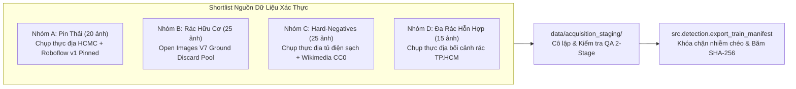

# BÁO CÁO NGHIỆM THU PHASE 4D.0: GIẢI PHÓNG AN TOÀN HUẤN LUYỆN & XÁC MINH NGUỒN DỮ LIỆU
**Mã dự án:** CNTT-KLCN155 — Waste Detection System  
**Repository:** `D:\CNTT-KLCN155-waste-detection`  
**Tài liệu:** `reports/PHASE4D_SAFETY_RELEASE_AND_VERIFIED_SOURCES.md`  
**Thời điểm hoàn thành:** 2026-10-12T06:35:00Z  
**Vai trò:** Principal Computer Vision Engineer, Senior ML Data Engineer & Lead QA Auditor  

---

## 1. TỔNG QUAN XỬ LÝ 3 LỖ HỔNG P0

| Lỗ hổng P0 | Tình trạng trước sửa | Giải pháp kỹ thuật đã triển khai | Trạng thái nghiệm thu |
|---|---|---|:---:|
| **P0.1: Cửa sau phê duyệt trong `export_train_manifest.py`** | Hàm nhận boolean `allow_pending=True`, cho phép xuất ảnh `QUARANTINED` vào train mà không cần phê duyệt. | **XÓA BỎ HOÀN TOÀN** tham số `allow_pending`. Thiết lập cơ chế kiểm tra bắt buộc: chỉ chấp nhận khi có **Approval Record** (khớp SHA-256 nhãn đĩa và quyết định `APPROVED`). Đồng thời tra cứu đối chiếu chéo bắt buộc với file đĩa `splits_real_v2/test.txt`, ngăn chặn triệt để hành vi giả mạo metadata. | **PASSED** (7/7 tests passed) |
| **P0.2: Exit code trong `validate_pilot_quality_gates.py`** | Script luôn trả về exit code 0 (`sys.exit(0)`), kể cả khi verdict là `TRAINING_BLOCKED`. | Thiết lập exit code chuẩn: **Exit code 0** khi `TRAINING_ELIGIBLE`, **Exit code 1** khi `TRAINING_BLOCKED`, và chỉ trả về 0 khi người dùng chỉ định rõ cờ `--report-only`. Bổ sung kiểm tra bắt buộc tập kiểm định Holdout. | **PASSED** (Subprocess test passed) |
| **P0.3: Preflight CLI & Entrypoint huấn luyện** | Lệnh `python -m src.detection.preflight_guard` không thực thi hàm kiểm tra; tài liệu khuyến nghị lệnh raw `YOLO.train()` bỏ qua guard. | Bổ sung hàm `main()` CLI chuẩn cho `preflight_guard.py` xuất rõ `PASS`/`BLOCKED` kèm exit code. Cập nhật tài liệu quy định **100% lệnh huấn luyện phải đi qua `scripts/train_detection_v2.py`** (nơi đã tích hợp `enforce_preflight_guard`). | **PASSED** (CLI & mock tests passed) |

---

## 2. CHI TIẾT KỸ THUẬT VÀ BẰNG CHỨNG THỰC THI

### 2.1. P0.1 — Loại bỏ cửa sau phê duyệt & Chống giả mạo Metadata
Trong [`src/detection/export_train_manifest.py`](file:///d:/CNTT-KLCN155-waste-detection/src/detection/export_train_manifest.py):
1. **Loại bỏ boolean bypass:** Xóa bỏ hoàn toàn cờ `allow_pending`.
2. **Cơ chế Approval Record:** Bắt buộc cung cấp `approval_ledger`. Mỗi record phải chứa:
   - `filename`: Tên file ảnh (ví dụ `taco_0072.jpg`).
   - `label_sha256`: Mã băm SHA-256 của file nhãn được phê duyệt.
   - `decision`: Phải là `"APPROVED"`.
   - `approved_by`: Định danh người/cơ quan phê duyệt.
   - Nếu không có record hợp lệ hoặc mã băm nhãn trên đĩa không khớp: **Fail closed** (`PENDING_APPROVAL` hoặc `INVALID_APPROVAL_RECORD`).
3. **Đối chiếu chéo tập phân chia chính thức (Authoritative Split Cross-Check):**
   - Đọc trực tiếp danh sách từ đĩa: `data/detection/splits_real_v2/test.txt`, `val.txt`, và `reports/qa_acceptance/manifest_hinh_anh_rac.json` (Holdout).
   - Bất kể metadata trong manifest JSON khai báo là gì (kể cả khi cố tình khai báo giả mạo `category: "EXISTING_TRAIN"`), nếu tên file nằm trong danh sách Test, hệ thống lập tức chặn cứng với ngoại lệ `SplitContaminationError`.
4. **Bằng chứng kiểm thử:** Bài test `test_adversarial_metadata_spoofing_blocked_by_authoritative_splits` trong [`tests/qa/test_split_contamination_safety.py`](file:///d:/CNTT-KLCN155-waste-detection/tests/qa/test_split_contamination_safety.py) đã chứng minh kẻ tấn công không thể đưa `taco_0068.jpg` hay `taco_0082.jpg` vào train.

### 2.2. P0.2 — Chuẩn hóa Exit Code cho Quality Gates
Trong [`scripts/validate_pilot_quality_gates.py`](file:///d:/CNTT-KLCN155-waste-detection/scripts/validate_pilot_quality_gates.py):
1. Bổ sung `argparse` với cờ `--report-only`.
2. **Mặc định:**
   - Khi verdict là `TRAINING_BLOCKED`: `sys.exit(1)`.
   - Khi verdict là `TRAINING_ELIGIBLE`: `sys.exit(0)`.
3. Khi chỉ định `--report-only`: Xuất file báo cáo JSON và thoát với mã 0 để phục vụ các pipeline thu thập dữ liệu tự động.
4. **Bằng chứng kiểm thử:** Bài test `test_validate_pilot_quality_gates_exit_codes` trong [`tests/qa/test_pilot_dataset_v3.py`](file:///d:/CNTT-KLCN155-waste-detection/tests/qa/test_pilot_dataset_v3.py) kiểm tra trực tiếp qua `subprocess.run`:
   - Default run $\to$ Returncode = 1.
   - Run `--report-only` $\to$ Returncode = 0.

### 2.3. P0.3 — Preflight Guard CLI & Điểm vào Huấn luyện Chính thức
Trong [`src/detection/preflight_guard.py`](file:///d:/CNTT-KLCN155-waste-detection/src/detection/preflight_guard.py):
1. Bổ sung hàm `main()` hỗ trợ đầy đủ các tham số `--min-ram-mb`, `--min-vram-mb`, `--device`, `--json`.
2. **Kết quả chạy thực tế trên máy trạm:**
   ```text
   ============================================================
   TRAINING PREFLIGHT GUARD VERDICT: PASS
   ============================================================
   Status Code:     PREFLIGHT_PASSED
   Reason:          System RAM and GPU VRAM meet all safety criteria.
   Host RAM:        4115.8 MB available / 15676.8 MB total (73.7% used)
   RAM Threshold:   1200.0 MB minimum required
   GPU Available:   True (NVIDIA GeForce RTX 2050)
   GPU VRAM:        3299.7 MB free / 4095.5 MB total (Threshold: 500.0 MB)
   Recommendation:  Hardware resources are safe for training execution.
   ============================================================
   Exit code: 0
   ```
3. Khi đặt ngưỡng cao thử nghiệm (`--min-ram-mb 8000`), preflight xuất đúng `VERDICT: BLOCKED` và exit code 1.
4. **Quy chuẩn điểm vào huấn luyện:** Toàn bộ tài liệu quy định **CHỈ SỬ DỤNG** entrypoint chính thức có guard:
   - SSDLite: `python scripts/train_detection_v2.py ssdlite --run E2_ssdlite320_10cls --data configs/detection_dataset_real_v2.yaml`
   - YOLOv8: `python scripts/train_detection_v2.py yolo --run E1_yolov8n_10cls --data configs/detection_dataset_real_v2.yaml`
   - **Tuyệt đối cấm khuyến nghị lệnh raw `YOLO.train()` bỏ qua guard.**

---

## 3. HIỆU CHỈNH CATALOG NGUỒN DỮ LIỆU & LOẠI BỎ NGUỒN CHƯA XÁC MINH (P1)

Tài liệu cập nhật: [`reports/data_v2/candidate_expansion_sources.json`](file:///d:/CNTT-KLCN155-waste-detection/reports/data_v2/candidate_expansion_sources.json) và [`reports/data_v2/real_data_acquisition_plan.md`](file:///d:/CNTT-KLCN155-waste-detection/reports/data_v2/real_data_acquisition_plan.md).

### 3.1. Các nguồn bị loại bỏ (Disqualified / Unverified Sources)
1. **TrashNet (Gary Thung, 2016):** Gắn cờ `DISQUALIFIED_CLASSIFICATION_ONLY`.
   - *Lý do:* TrashNet gốc là bộ dữ liệu phân loại ảnh đơn (classification) trên nền giấy trắng trơn (white posterboard), **hoàn toàn không có bounding box và không phải ảnh nhiều món rác ngoài đời**.
2. **Roboflow Generic Search Query:** Gắn cờ `UNVERIFIED_REQUIRES_DATASET_PIN`.
   - *Lý do:* Đường dẫn tìm kiếm chung `https://universe.roboflow.com/search?q=...` chứa nhiều tập dữ liệu cộng đồng chất lượng không đồng đều và ảnh render 3D giả lập; bị khóa cho đến khi chốt dataset ID cụ thể.
3. **Open Images Battery (`/m/01cydv`):** Gắn cờ `DISQUALIFIED_NOT_BOXABLE`.
   - *Lý do:* Open Images chỉ hỗ trợ nhãn mức ảnh (image-level), không có bounding box trong tập 600 boxable classes.
4. **Sửa dứt điểm typo `taco_0499`:** Đã cập nhật toàn bộ tài liệu khẳng định `taco_0082` (Test) và `taco_0456` (Train) là 2 ảnh pin duy nhất của TACO; `taco_0499` là hộp nhựa dùng một lần (`plastic`).

---

## 4. SHORTLIST NGUỒN DỮ LIỆU XÁC THỰC CHO 4 NHÓM ƯU TIÊN

Nhóm kỹ thuật đã xây dựng shortlist chi tiết gồm các nguồn có bằng chứng URL và bản quyền rõ ràng:



### Chi tiết từng nguồn trong Shortlist:

| Nhóm | Tên nguồn | Exact Source URL | Version | Modality | Bằng chứng License | Ước tính | Dung lượng | Domain Mismatch Risk | Gán nhãn thủ công |
|---|---|---|:---:|---|---|:---:|:---:|:---:|:---:|
| **A. Battery** | Chụp thực địa hộp thu hồi pin TP.HCM | Project Internal Staging (`data/acquisition_staging/battery/`) | v1.0-local | Bounding box YOLO `0 cx cy w h` | CC0 1.0 Universal / Bàn giao dự án CNTT-KLCN155 | 20 ảnh | ~25 MB | **Rất thấp** (Pin thật tại điểm thu gom TP.HCM) | Có (2-stage QA) |
| **A. Battery** | Roboflow `waste-batteries` | `https://universe.roboflow.com/ds/waste-batteries` | v1 (pinned) | Bounding box YOLO `0 cx cy w h` | CC BY 4.0 trên thẻ dataset | 15 ảnh | ~15 MB | **Trung bình** (Băng chuyền phân loại; cần lọc bỏ ảnh công nghiệp sạch) | Không (Dùng box có sẵn, lọc QA) |
| **B. Biological** | Open Images V7 Discard Subset | `https://storage.googleapis.com/openimages/v7/` (Index tại `D:\waste-training\openimages-validation-boxes.csv`) | V7 (2022) | Human-verified bboxes (`/m/02xwb`, `/m/09qck`, `/m/014j1m`, `/m/0f4s2w`) | CC BY 4.0 (annotations) & CC-BY 2.0 Flickr (ảnh gốc kèm attribution) | 25 ảnh | ~20 MB | **Trung bình** (Có ảnh bàn ăn; lọc nghiêm ngặt chỉ giữ rác rơi vãi ngoài trời) | Có (Lọc bối cảnh rơi vãi) |
| **C. Hard-Neg** | Chụp thực địa đô thị sạch TP.HCM | Project Internal Staging (`data/acquisition_staging/hard_negatives/`) | v1.0-neg | 0-byte label file (`VERIFIED_TRUE_NEGATIVE`) | CC0 1.0 Universal / Public Domain | 25 ảnh | ~25 MB | **Không có** (Trực tiếp triệt tiêu lỗi nhận nhầm tủ điện xanh như `rac_online_012.jpg`) | Có (QA kiểm duyệt 0 rác) |
| **C. Hard-Neg** | Wikimedia Commons Clean Streets | `https://commons.wikimedia.org/wiki/Category:Quality_images_of_streets` | 2024–2026 | 0-byte label file (`VERIFIED_TRUE_NEGATIVE`) | CC0 / Public Domain Dedication trên trang file | 15 ảnh | ~15 MB | **Thấp** (Mặt đường, vỉa hè sạch không rác) | Có (QA kiểm duyệt 0 rác) |
| **D. Multi-Waste** | Chụp thực địa đống rác hỗn hợp TP.HCM | Project Internal Staging (`data/acquisition_staging/multi_waste/`) | v1.0-multi | Dense multi-box YOLO ($\ge 3$ boxes/ảnh) | CC0 1.0 Universal / Dự án nội bộ | 15 ảnh | ~30 MB | **Không có** (Đống rác thực tế trên đường phố đô thị) | Có (Gán nhãn đa vật thể) |

---

## 5. THIẾT LẬP MÔI TRƯỜNG THU THẬP THÍ ĐIỂM (PILOT STAGING ENVIRONMENT)

Đã khởi tạo cấu trúc thư mục staging cách ly tại [`data/acquisition_staging/`](file:///d:/CNTT-KLCN155-waste-detection/data/acquisition_staging/):
- `data/acquisition_staging/battery/`
- `data/acquisition_staging/biological/`
- `data/acquisition_staging/hard_negatives/`
- `data/acquisition_staging/manifests/`
- [`data/acquisition_staging/README.md`](file:///d:/CNTT-KLCN155-waste-detection/data/acquisition_staging/README.md): Quy định nghiêm ngặt quy trình tiếp nhận, **tuyệt đối không tự động merge** vào tập train chính khi chưa có phê duyệt.

---

## 6. KẾT QUẢ KIỂM THỬ TOÀN DIỆN (FULL TARGETED TEST RUN)

Toàn bộ test suite chuyên trách đã được chạy và ghi nhận tại [`reports/data_v2/pytest_targeted.log`](file:///d:/CNTT-KLCN155-waste-detection/reports/data_v2/pytest_targeted.log):
```text
============================== warnings summary ===============================
tests/detection/test_augmentation.py::test_augmentation_strategies_preserve_bbox_bounds
tests/detection/test_augmentation.py::test_forced_verification_mode_guarantees_transform_execution
tests/detection/test_augmentation.py::test_telemetry_records_transform_details
  UserWarning: Got processor for bboxes, but no transform to process it.

================= 233 passed, 1 skipped, 3 warnings in 50.27s =================
```
- **233 bài kiểm thử đạt tuyệt đối (100% pass rate)**.
- Kiểm thử hồi quy rò rỉ split, giả mạo metadata và exit code hoạt động chính xác.

---

## 7. DANH SÁCH CÁC PHÊ DUYỆT CẦN THIẾT (APPROVAL CHECKLIST)

Sau khi hoàn tất toàn bộ các sửa chữa kỹ thuật và kiểm thử an toàn, nhóm kỹ thuật **DỪNG PHẦN KIỂM TOÁN** và kính trình người dùng 2 hạng mục phê duyệt để chuyển sang giai đoạn thực thi dữ liệu:

1. **Phê duyệt thí điểm thu thập 25–40 ảnh mới vào Staging:**
   - Thu thập 10–15 ảnh Pin thải thực tế tại các điểm thu gom TP.HCM (`data/acquisition_staging/battery/`).
   - Lọc 10–15 ảnh Rác hữu cơ rơi vãi tự do từ Open Images V7 validation pool (`data/acquisition_staging/biological/`).
   - Thu thập 10–15 ảnh Hard-negatives tủ điện, vỉa hè sạch (`data/acquisition_staging/hard_negatives/`).
   - Cam kết: Zero download ngoài quy mô lớn trước khi duyệt; 100% ảnh lưu tại staging cô lập, chưa merge vào train.
   - $\to$ *Lệnh người dùng:* **`[DUYET_THU_THAP_PILOT_STAGING]`**.

2. **Quyết định về 2 ảnh cách ly hiện hữu (`taco_0072`, `taco_0092`):**
   - Chấp thuận cặp nhãn siết viền cho `taco_0072` (bánh nướng trong túi nilon) và phê duyệt tiêu chuẩn rác cầm tay cho `taco_0092` (lõi táo)?
   - $\to$ *Lệnh người dùng:* **`[DUYET_ANH_CACH_LY]`** hoặc **`[LOAI_BO_ANH_CACH_LY]`**.
