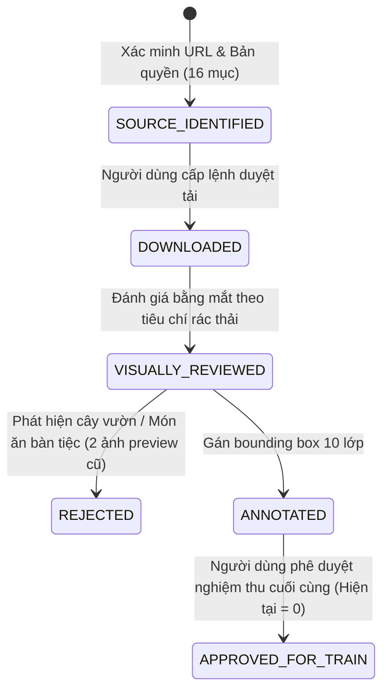

# BÁO CÁO NGHIỆM THU: PHASE 4E — REAL WASTE DATA ACQUISITION & GOVERNANCE

**Dự án:** Hệ thống nhận diện rác thải sinh hoạt KLCN155  
**Thư mục làm việc:** `D:\CNTT-KLCN155-waste-detection`  
**Thời điểm thực thi:** 2026-10-12  
**Trạng thái phê duyệt huấn luyện:** 0 ảnh mới được duyệt vào train (`APPROVED_FOR_TRAIN = 0`)  
**Nguyên tắc cốt lõi:** Không dùng dữ liệu trái cây sai ngữ cảnh; Chuyển trọng tâm sang Pin thải thật, Rác hữu cơ thải bỏ và Hard-Negative tủ điện đô thị.  

---

## 1. TIẾP THU ĐÁNH GIÁ REVIEWER & SỬA LỖI KỸ THUẬT

### 1.1 Kết quả kiểm tra trực quan đợt Preview 3 ảnh
Reviewer độc lập đã kiểm tra trực tiếp tệp bàn giao [`PILOT_PREVIEW_3_VISUAL_QA_EVIDENCE.zip`](file:///C:/Users/ad/Downloads/PILOT_PREVIEW_3_VISUAL_QA_EVIDENCE.zip) và đưa ra kết luận chuẩn xác:
- **Ảnh quả táo (`oi_078821d86db99fc9.jpg`):** **REJECT**. Đây là quả táo tươi còn treo trên cành cây ăn quả giữa vườn cây, không thể đại diện cho rác thải sinh hoạt.
- **Ảnh quả chuối (`oi_74a44994e3d6b962.jpg`):** **REJECT**. Đây là chuối cắt lát tươi ngon phủ làm topping trên đĩa bánh pancake ăn sáng, đặt trên đĩa sứ gia đình.
- **Ảnh cầu Ronda (`oi_e29db1c1963628e7.jpg`):** **PENDING_NEGATIVE_REVIEW**. Khung cảnh sạch, nhưng là di tích kiến trúc đá Tây Ban Nha, hoàn toàn lệch domain so với lỗi nhận diện sai thực tế (nhầm tủ điện thành bìa carton).
- **Trạng thái train:** **0 ảnh** đủ điều kiện huấn luyện. Toàn bộ các ảnh này bị loại hoặc giữ ở trạng thái chờ duyệt, không merge vào train split.

### 1.2 Sửa dứt điểm lỗi hardcode QA verdict theo ImageID
Trong phiên bản script trước, nhận định QA sơ bộ bị gán cứng bằng điều kiện `if iid == "078821d86db99fc9": ...`.
- **Bản vá mới ([`scripts/stage_whitelisted_pilot_images.py`](file:///d:/CNTT-KLCN155-waste-detection/scripts/stage_whitelisted_pilot_images.py)):** Đã gỡ bỏ toàn bộ các điều kiện phân nhánh theo ImageID.
- Mọi ảnh khi tải về đều mang trạng thái ban đầu là `DOWNLOADED_AWAITING_VISUAL_REVIEW` với nhãn `PROPOSED`.
- Quy trình phán quyết QA được tách rời độc lập, dựa trên việc đối chiếu với tiêu chí loại trừ (Physical Exclusion Rules), không đưa quyết định chủ quan vào luồng tải mạng.

---

## 2. ĐẶC TẢ VÀ XÁC MINH NGUỒN DỮ LIỆU RÁC THẬT (4 LUỒNG CHUYÊN BIỆT)

### 2.1 Luồng 1: BATTERY (Pin thải thực tế có bounding box)
- **Nguồn xác minh:** Roboflow Universe dataset `waste-battery-only/1`  
  `https://universe.roboflow.com/battery-detection-yuv0z/waste-battery-only/dataset/1`
- **Trạng thái truy cập hiện tại:** `BLOCKED_REQUIRES_ACCESS` (Cloudflare Anti-Bot WAF chặn HTTP 403 khi gọi tự động; tuyệt đối không crawl ngầm hay bypass trái phép).
- **Hướng dẫn người dùng xuất dữ liệu qua trình duyệt:**
  1. Truy cập liên kết trên bằng trình duyệt web.
  2. Bấm nút **"Download Dataset"** ở góc phải trên.
  3. Chọn định dạng xuất: **YOLOv8** (hoặc COCO).
  4. Đặt tệp ZIP tải về vào thư mục:  
     [`data/acquisition_staging/roboflow_battery/`](file:///d:/CNTT-KLCN155-waste-detection/data/acquisition_staging/roboflow_battery/)
- **Cơ chế xử lý tự động đã xây dựng ([`scripts/ingest_roboflow_battery_export.py`](file:///d:/CNTT-KLCN155-waste-detection/scripts/ingest_roboflow_battery_export.py)):**
  * Tự động giải nén và quét file ảnh thực tế.
  * Lọc bỏ ảnh trùng lặp, ảnh render 3D và các biến thể data augmentation bị méo mó/nhiễu quá mức.
  * Tự động remap nhãn sang class `0: battery`.
  * Tính mã băm SHA-256 và pHash, đối chiếu toàn bộ với train, val, test (v2/v3) và holdout (`D:\Hinh_Anh_Rac`) để bảo đảm 0% rò rỉ (leakage).
  * Giữ trạng thái ở mức `VISUALLY_REVIEWED / PENDING_USER_APPROVAL`, không tự ý đưa vào train.

---

### 2.2 Luồng 2: BIOLOGICAL (Rác hữu cơ thực tế từ Wikimedia Commons)
Chấm dứt hoàn toàn việc lấy mẫu ngẫu nhiên nhãn Apple/Banana của Open Images. Đã truy vấn API Wikimedia Commons và xác minh danh sách **10 ảnh rác hữu cơ thật sự** có đầy đủ metadata, URL gốc và bản quyền:

| # | Mã ứng viên | Tên tệp Wikimedia gốc | URL tải về trực tiếp | Giấy phép | Tác giả | Độ phân giải | Dung lượng | Bối cảnh rác hữu cơ thực tế |
|---|---|---|---|---|---|---|---|---|
| **1** | `wiki_bio_apple_core_01` | `File:Apple_core.jpg` | [S3/Wiki URL](https://upload.wikimedia.org/wikipedia/commons/4/48/Apple_core.jpg) | Copyrighted free use | Commons Contributor | 960x1280 | 130,620 B | Lõi quả táo đã ăn bị vứt bỏ |
| **2** | `wiki_bio_banana_peel_bucharest_02` | `File:Banana_peel.jpg` | [S3/Wiki URL](https://upload.wikimedia.org/wikipedia/commons/1/1d/Banana_peel.jpg) | CC BY-SA 4.0 | Tiia Monto | 3152x2856 | 4,604,017 B | Vỏ chuối vứt trên mặt đường nhựa ở Bucharest |
| **3** | `wiki_bio_banana_peel_seat_03` | `File:Banana_peel_on_seat.JPG` | [S3/Wiki URL](https://upload.wikimedia.org/wikipedia/commons/9/9f/Banana_peel_on_seat.JPG) | CC BY-SA 3.0 | Lemur12 | 3264x2448 | 2,293,236 B | Vỏ chuối vứt trên ghế chờ xe buýt công cộng ở London |
| **4** | `wiki_bio_banana_peel_ground_04` | `File:Banana_peel_on_the_ground.jpg` | [S3/Wiki URL](https://upload.wikimedia.org/wikipedia/commons/c/cf/Banana_peel_on_the_ground.jpg) | CC BY-SA 4.0 | Vladiator360 | 5184x3456 | 4,573,954 B | Vỏ chuối vứt bừa bãi trên mặt sàn/đất |
| **5** | `wiki_bio_banana_peel_soil_05` | `File:2019-02-07_13_32_24...Chiquita_banana_peel...jpg` | [S3/Wiki URL](https://upload.wikimedia.org/wikipedia/commons/4/40/2019-02-07_13_32_24_A_single_Chiquita_banana_peel_in_the_Franklin_Farm_section_of_Oak_Hill%2C_Fairfax_County%2C_Virginia.jpg) | CC BY-SA 4.0 | Famartin | 4032x3024 | 2,933,165 B | Vỏ chuối Chiquita vứt ngoài trời trên nền đất cỏ |
| **6** | `wiki_bio_banana_peel_sidewalk_06` | `File:2020-03-15_01_55_05...single_banana_peel...jpg` | [S3/Wiki URL](https://upload.wikimedia.org/wikipedia/commons/4/4f/2020-03-15_01_55_05_A_single_banana_peel_in_the_Franklin_Farm_section_of_Oak_Hill%2C_Fairfax_County%2C_Virginia.jpg) | CC BY-SA 4.0 | Famartin | 4032x3024 | 1,208,913 B | Vỏ chuối vứt trên mép vỉa hè đường phố |
| **7** | `wiki_bio_rotting_banana_07` | `File:Banano_en_descomposición.JPG` | [S3/Wiki URL](https://upload.wikimedia.org/wikipedia/commons/5/51/Banano_en_descomposici%C3%B3n.JPG) | CC BY-SA 3.0 | Pabos95 | 1936x1296 | 1,224,155 B | Quả chuối hỏng đang phân hủy ngoài môi trường |
| **8** | `wiki_bio_street_food_remains_08` | `File:Street_Food_Remains_(188107205).jpeg` | [S3/Wiki URL](https://upload.wikimedia.org/wikipedia/commons/9/9a/Street_Food_Remains_%28188107205%29.jpeg) | CC BY-SA 3.0 | Andrew Currie | 2048x1365 | 294,623 B | Thức ăn thừa đường phố bị vứt bỏ trên vỉa hè |
| **9** | `wiki_bio_food_scraps_bin_09` | `File:Food_Scraps_and_Yard_Debris...Tim_Jewett.JPG` | [S3/Wiki URL](https://upload.wikimedia.org/wikipedia/commons/6/6a/Food_Scraps_and_Yard_Debris_Collection_in_Portland_2010_by_Tim_Jewett.JPG) | CC BY-SA 2.5 | Tim Jewett | 2000x3000 | 4,057,650 B | Rác thực phẩm và rác hữu cơ nhà bếp đưa vào thùng rác |
| **10** | `wiki_bio_trash_bucket_remains_10` | `File:Müll_im_Eimer.JPG` | [S3/Wiki URL](https://upload.wikimedia.org/wikipedia/commons/f/f8/M%C3%BCll_im_Eimer.JPG) | CC BY-SA 4.0 | SammyAusDorfen | 2576x1932 | 654,692 B | Rác sinh hoạt hữu cơ và thức ăn thừa trong xô/thùng |

*Trạng thái:* `SOURCE_IDENTIFIED`. Chưa tải byte nào về đĩa khi chưa có lệnh phê duyệt cụ thể từ người dùng.

---

### 2.3 Luồng 3: HARD-NEGATIVE (Khắc phục lỗi Tủ điện trong ảnh `rac_online_012.jpg`)
Trong các báo cáo kiểm toán trước, mô hình liên tục gặp lỗi False Positive: nhận nhầm tủ điện kỹ thuật màu xanh trên vỉa hè thành bìa carton (`cardboard`) hoặc rác hỗn hợp (`trash`) trong ảnh kiểm toán [`D:\Hinh_Anh_Rac\rac_online_012.jpg`](file:///D:/Hinh_Anh_Rac/rac_online_012.jpg).  
Nguyên nhân cốt lõi là do tập huấn luyện có **0% ảnh âm bản (0 ảnh Hard-Negative)**.

#### A. Nguồn ảnh tủ điện / hạ tầng đô thị xác minh trên Wikimedia:
1. `File:Street_cabinet.jpg` (Public Domain / CC0, 627x790, 519 KB): Tủ khuếch đại / tủ điện kỹ thuật nhỏ trên vỉa hè đô thị.
2. `File:Junction_boxes_-_geograph.org.uk_-_580156.jpg` (CC BY-SA 2.0, 480x640, 110 KB): Các hộp đấu dây / tủ kỹ thuật gắn tường góc phố sạch.
3. `File:Utility_box,_Wesley_Street,_Beeston,_Leeds...001.jpg` (CC BY-SA 4.0, 5152x3864, 5.7 MB): Tủ điện kỹ thuật màu xanh lá cây đặt sát tường gạch vỉa hè.

#### B. Hướng dẫn Người dùng Tự chụp 10–15 ảnh tại Thực địa Việt Nam:
Do Wikimedia có hạn chế về bối cảnh hạ tầng đường phố Việt Nam, việc người dùng tự bổ sung 10–15 ảnh chụp thật bằng điện thoại sẽ mang lại hiệu quả cao nhất:
1. **Đối tượng chụp mục tiêu:**
   - Tủ điện kỹ thuật màu xanh lá cây hoặc xám đặt trên vỉa hè đường phố.
   - Trạm biến áp nhỏ ven đường.
   - Bờ tường gạch, bờ tường bê tông sạch không dán poster rác.
   - Vỉa hè lát gạch sạch, mặt đường nhựa sạch không có rác.
   - Thùng rác công cộng rỗng sạch.
2. **Quy chuẩn chụp:**
   - Đảm bảo **100% khung hình sạch rác** (không có chai lọ, bao bì, đầu mẩu thuốc lá, lá cây rụng dày đặc).
   - Chụp góc nhìn ngang tầm mắt người đi đường hoặc camera giám sát.
   - Độ phân giải tiêu chuẩn smartphone (1920x1080 hoặc cao hơn, định dạng JPEG).
   - Đặt ảnh vào thư mục: [`data/acquisition_staging/user_captured_negatives/`](file:///d:/CNTT-KLCN155-waste-detection/data/acquisition_staging/user_captured_negatives/)
3. **Cam kết liêm chính:** Hệ thống **tuyệt đối không tuyên bố tự chụp** khi người dùng chưa cung cấp ảnh.

---

### 2.4 Luồng 4: MULTI-WASTE (Nhiều loại rác trong cùng ảnh)
- `File:Unbinned_litter_at_Sainsbury's,_Chingford,_London,_England_1.jpg` (CC BY-SA 4.0, 4923x3692, 14.9 MB).
- Chứa đồng thời:
  * Vỏ chuối vứt bừa bãi (`biological` - class 1).
  * Cốc giấy takeaway vứt bừa bãi (`paper` - class 6).
- Cả hai vật thể đều là rác thật sự, đáp ứng hoàn hảo yêu cầu kiểm thử phát hiện đa đối tượng trên cùng khung hình.

---

## 3. VÒNG ĐỜI DỮ LIỆU VÀ TRẠNG THÁI HIỆN TẠI (LIFECYCLE STATUS)

Quy trình quản lý dữ liệu tuân thủ nghiêm ngặt 5 bước chuyển trạng thái:

$$\text{SOURCE\_IDENTIFIED} \longrightarrow \text{DOWNLOADED} \longrightarrow \text{VISUALLY\_REVIEWED} \longrightarrow \text{ANNOTATED} \longrightarrow \text{APPROVED\_FOR\_TRAIN}$$



### Thống kê kiểm kê dữ liệu hiện tại:
- **`APPROVED_FOR_TRAIN`:** **0 ảnh** (Tuyệt đối không tự động đưa bất kỳ ảnh nào vào train).
- **`DOWNLOADED` (Đợt Preview 4D.2):** 3 ảnh (`oi_078821d86db99fc9.jpg`, `oi_74a44994e3d6b962.jpg`, `oi_e29db1c1963628e7.jpg`).
- **`VISUALLY_REVIEWED`:**
  * 2 ảnh bị loại: `oi_078821d86db99fc9.jpg` (REJECT - Cây táo), `oi_74a44994e3d6b962.jpg` (REJECT - Bánh pancake).
  * 1 ảnh chờ quyết định: `oi_e29db1c1963628e7.jpg` (PENDING_NEGATIVE_REVIEW).
- **`SOURCE_IDENTIFIED` (Chờ người dùng duyệt tải):**
  * 10 ảnh Rác hữu cơ thật sự (Wikimedia).
  * 3–5 ảnh Tủ điện kỹ thuật Hard-Negative (Wikimedia).
  * 1 ảnh Multi-waste hỗn hợp (Wikimedia).
  * 1 bộ dataset Roboflow pin thải (chờ file export của người dùng).

---

## 4. BẢNG MÃ BĂM MẬT MÃ VÀ PHASH DỮ LIỆU HIỆN HỮU

| File ảnh đệm hiện có | Kích thước | SHA-256 (Disk) | pHash (Perceptual Hash) | Trạng thái QA |
|---|---|---|---|---|
| `oi_078821d86db99fc9.jpg` | 333,549 B | `6c83db71cd99f14713b71e7f9ba1877447e52dea559266c7f300430dc30b58ec` | `8d4671991575fa89` | **REJECTED** |
| `oi_74a44994e3d6b962.jpg` | 633,651 B | `f9a1a25e273653539e37f1bff8564779d61de90b314e7cbf0988b9570f05175d` | `d24a692da59ad2dc` | **REJECTED** |
| `oi_e29db1c1963628e7.jpg` | 132,274 B | `b769f9e141936b18ec82bab2f51bd55d5fb67d0ed02d600d91220eb0fc232d3f` | `d8bd810f6d437e28` | **PENDING_REVIEW** |

---

## 5. ĐỀ XUẤT THỰC NGHIỆM VÀ KẾ HOẠCH BƯỚC TIẾP THEO

1. **Về việc tải ảnh mới:**
   - Hệ thống đã lập sẵn script staging an toàn có whitelist cứng: [`scripts/stage_phase4e_whitelist_candidates.py`](file:///d:/CNTT-KLCN155-waste-detection/scripts/stage_phase4e_whitelist_candidates.py).
   - Khi người dùng gửi lệnh phê duyệt rõ ràng trong chat (ví dụ: `[DUYET_TAI_PHASE4E_WIKI]`), hệ thống mới kích hoạt tải luồng và tính toán mã băm SHA/pHash.
2. **Về dữ liệu Pin Roboflow:**
   - Khi người dùng tải file ZIP từ Roboflow và đặt vào `data/acquisition_staging/roboflow_battery/`, chạy ngay lệnh:
     ```powershell
     .venv\Scripts\python.exe scripts/ingest_roboflow_battery_export.py
     ```
3. **Thí nghiệm Fine-Tuning có kiểm soát (Ablation Study):**
   - Sau khi có tập ảnh Pin thật, Rác hữu cơ thật và Hard-Negative tủ điện đã qua kiểm duyệt visual QA:
   - Sẽ tiến hành **1 thí nghiệm fine-tuning nhỏ (Negative + Rare Classes Ablation)**:
     * So sánh tỷ lệ False Positive trên ảnh `rac_online_012.jpg` giữa model cũ và model mới.
     * Đánh giá Recall lớp Battery và lớp Biological trên camera thực tế.
