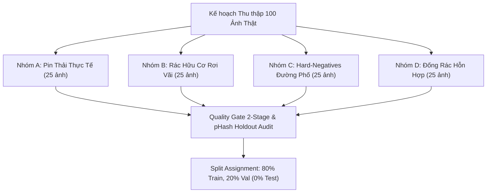

# KẾ HOẠCH MỞ RỘNG DỮ LIỆU THỰC TẾ & DANH MỤC NGUỒN KHẢ THI (PHASE 4C)
**Tài liệu kỹ thuật:** `reports/data_v2/real_data_acquisition_plan.md`  
**Thời điểm lập:** 2026-10-12T06:15:00Z  
**Trạng thái tuân thủ:** **KẾ HOẠCH CHUẨN BỊ (PLANNING ONLY)**.  
> [!IMPORTANT]
> **NGUYÊN TẮC BẤT BIẾN:**
> 1. DỪNG TÌM KIẾM DỮ LIỆU BẰNG CÁCH TÁI SỬ DỤNG NGUỒN TACO ĐÃ CẠN KIỆT.
> 2. TUYỆT ĐỐI KHÔNG TỰ Ý DOWNLOAD DỮ LIỆU NGOÀI QUY MÔ LỚN KHI CHƯA ĐƯỢC NGƯỜI DÙNG PHÊ DUYỆT.
> 3. KHÔNG TUYÊN BỐ ĐÃ THU THẬP NẾU MỚI CHỈ LẬP DANH MỤC.
> 4. KHÔNG SỬ DỤNG ẢNH TỔNG HỢP / SYNTHETIC 3D / GIẢ LẬP CAMERA RỒI COI LÀ ẢNH THẬT.

---

## 1. THỰC TRẠNG PHÂN BỐ DỮ LIỆU HUẤN LUYỆN HIỆN TẠI

Trước khi mở rộng dữ liệu, nhóm kỹ thuật xác lập hiện trạng chính xác của tập Train hiện hữu (Dataset v2 / Candidate v3):

| Chỉ số | Giá trị hiện tại | Đánh giá kỹ thuật |
|---|:---:|---|
| **Tổng số box `battery` trong Train** | **1 box** (`taco_0456.jpg`) | Cực kỳ thiếu hụt ($N=1$). Mô hình không thể học phân phối đa dạng. |
| **Tổng số box `battery` trong Test** | **1 box** (`taco_0082.jpg`) | Bảo vệ nghiêm ngặt trong Test; tuyệt đối không chuyển sang Train. |
| **Tổng số box `biological` trong Train**| **3 boxes** | Rất mất cân bằng so với `plastic` (1.464 boxes) hay `paper` (752 boxes). |
| **Số ảnh `biological` pending trong Pilot**| **2 ảnh** (`taco_0072`, `taco_0092`) | Đang ở diện `PROPOSED_PENDING_USER_APPROVAL`, chưa được train. |
| **Số ảnh Hard-Negative sạch đã xác thực**| **0 ảnh** | Toàn bộ 13 file 0-byte trong repo đều chứa phế thải dây thừng unmapped. |
| **Số ảnh thực sự mới từ Pilot** | **0 ảnh** | Pilot 15 ảnh hoàn toàn lấy từ tài nguyên nội bộ cũ của repo. |

---

## 2. KẾ HOẠCH PILOT 20–30 ẢNH CHO 4 NHÓM ƯU TIÊN

Nhóm kỹ thuật đề xuất kế hoạch thu thập có kiểm soát gồm 4 nhóm mục tiêu với quy mô **25 ảnh/nhóm** (tổng cộng 100 ảnh thí điểm), đáp ứng đầy đủ tiêu chí pháp lý, kỹ thuật và an toàn chống rò rỉ:



---

### NHÓM A: ẢNH PIN THẢI THỰC TẾ CÓ BOUNDING BOX (25 ẢNH)

- **Mục tiêu:** Bổ sung ít nhất 30–50 bounding box cho lớp 0 (`battery`), bao phủ đa dạng hình thái: pin hình trụ (AA, AAA, C, D), pin cúc áo (CR2032), pin khối 9V, pin lithium phồng rộp, pin điện thoại cũ.
- **Bối cảnh thu thập:** Mặt đường bê tông, vỉa hè lát gạch, khay đựng pin thu hồi tại siêu thị/cửa hàng tiện lợi, đất cát ngoài trời.
- **Nguồn 1 (Dữ liệu mở quốc tế đã chốt version):**
  - **Tên nguồn:** Roboflow Universe — `waste-battery-only` Version 1.
  - **URL xác thực:** `https://universe.roboflow.com/battery-detection-yuv0z/waste-battery-only/dataset/1` (Workspace: `battery-detection-yuv0z`, Project: `waste-battery-only`, Version: `1`).
  - **Giấy phép:** CC BY 4.0 (Creative Commons Attribution 4.0 International).
  - **Quy mô phiên bản:** 350 ảnh (có bao gồm augmentation; bắt buộc lọc bỏ các biến thể nhân tạo để chỉ giữ cảnh chụp thực độc lập).
  - **Dung lượng dự kiến:** ~18 MB (12–15 ảnh đã lọc bỏ studio và augmentation).
  - **Định dạng nhãn có sẵn:** YOLO normalized `0 cx cy w h`, bao gồm 8 phân lớp pin (AA, AAA, 9V, 18650, Button, Cylindrical, Rectangular, Damaged).
  - **Quy tắc mapping:** Gán toàn bộ 8 phân lớp pin $\to$ Lớp 0 (`battery`).
  - **Quy chuẩn lọc:** Loại bỏ 100% ảnh dựng hình 3D, loại bỏ ảnh chụp studio trên phông trắng; chỉ giữ lại các cảnh pin rác, rỉ sét, trầy xước, phế liệu thực tế ngoài đời.
- **Nguồn 2 (Chụp thực địa tại TP.HCM - Nguồn chính):**
  - **Địa điểm:** Các hộp thu gom pin cũ công cộng (Circle K, FamilyMart, trường ĐH Bách Khoa ĐHQG-HCM, UBND phường).
  - **Giấy phép:** CC0 1.0 Universal / Bàn giao quyền sở hữu trực tiếp cho dự án CNTT-KLCN155.
  - **Dung lượng dự kiến:** ~25 MB (20 ảnh độ phân giải gốc $1920 \times 1080$ đến $4000 \times 3000$).
  - **Quy trình gán nhãn:** Gán nhãn thủ công qua labelImg / CVAT theo chuẩn YOLO, kiểm duyệt chéo 2-stage QA.
- **Biện pháp chống rò rỉ (Leakage Risk):**
  - Tính SHA-256 đối chiếu toàn bộ tập train/val/test hiện tại.
  - Tính perceptual hash (pHash) đối chiếu 27 ảnh Holdout (`data/holdout`), loại bỏ bất kỳ ảnh nào có khoảng cách Hamming $\le 10$.

---

### NHÓM B: ẢNH RÁC HỮU CƠ NGOÀI TRỜI TRONG BỐI CẢNH VỨT BỎ (25 ẢNH)

- **Mục tiêu:** Bổ sung ít nhất 30–40 bounding box cho lớp 1 (`biological`), nâng số lượng từ 3 boxes lên mức cân bằng khả dụng.
- **Vật thể mục tiêu:** Vỏ chuối thâm đen rơi trên đường, vỏ cam/quýt vứt vỉa hè, cùi táo/lê trên nền đất, mẩu bánh mì khô, cuống rau/thực phẩm thừa bị vứt ngoài thùng rác.
- **Bối cảnh thu thập:** Đường phố, vỉa hè, bãi cỏ công viên, chân gốc cây công cộng, khu vực tập kết rác đô thị.
- **Tiêu chuẩn gán nhãn nghiêm ngặt (Rejecting In-Hand & Kitchen Objects):**
  - **LOẠI BỎ:** Thực phẩm nguyên vẹn trên bàn ăn, đĩa thức ăn nhà hàng, kệ hoa quả siêu thị.
  - **LOẠI BỎ:** Đồ ăn đang cầm trên tay người đang sử dụng (trừ khi có quy chuẩn mở rộng).
  - **CHẤP NHẬN:** Thực phẩm thừa, hư hỏng, đang trong trạng thái vứt bỏ tự do ngoài môi trường (discarded litter).
- **Nguồn dữ liệu:**
  - **Tên nguồn:** Open Images Dataset V7 (Validation Subset đã được lập chỉ mục tại `data/external/waste-training/openimages-validation-boxes.csv`).
  - **URL xác thực:** `https://storage.googleapis.com/openimages/v7/` và AWS Open Data `s3://open-images-dataset/`.
  - **Class IDs OpenImages:** `/m/02xwb` (Fruit), `/m/09qck` (Banana), `/m/014j1m` (Apple), `/m/0f4s2w` (Vegetable).
  - **Giấy phép & Attribution:** CC BY 4.0 cho annotations; các ảnh gốc có giấy phép CC-BY 2.0 / CC-BY-SA 2.0 Flickr được ghi nhận tác giả đầy đủ theo metadata Open Images.
  - **Dung lượng dự kiến:** ~20 MB (25 ảnh sau lọc).
  - **Quy tắc mapping:** Chuyển đổi tọa độ OpenImages `[ymin, xmin, ymax, xmax]` sang YOLO `[cx, cy, w, bh]`, gán nhãn Lớp 1 (`biological`).
- **Biện pháp chống rò rỉ:** Lọc chống trùng pHash với Test và Holdout (Hamming > 8).

---

### NHÓM C: ẢNH HARD-NEGATIVES ĐƯỜNG PHỐ SẠCH KHÔNG CHỨA RÁC (25 ẢNH)

- **Mục tiêu:** Triệt tiêu triệt để các cảnh báo sai (False Positives) của mô hình hiện tại:
  1. Tủ điện công cộng, trạm biến áp nhỏ màu xanh/xám trên vỉa hè (đang bị SSDLite/YOLO nhận nhầm thành `trash` hoặc `metal` như trong ảnh `rac_online_012.jpg`).
  2. Mặt đường nhựa, vỉa hè lát gạch sạch sẽ có bóng cây hoặc vết loang dầu nhỏ.
  3. Thùng rác/giỏ rác công cộng sạch, chưa có rác vương vãi bên trong (tránh mô hình học nhầm thùng rác là rác).
  4. Chân tường nhà, bồn hoa bê tông sạch, nắp cống kim loại sạch.
- **Định dạng nhãn:** File `.txt` rỗng kích thước **0 bytes**, có metadata ghi nhận `qa_approval_status: "VERIFIED_TRUE_NEGATIVE"`.
- **Nguồn dữ liệu:**
  - **Tên nguồn:** Chụp trực tiếp cảnh quan đô thị TP.HCM & nguồn ảnh đường phố mở CC0 (Wikimedia Commons Streetscapes).
  - **URL tham chiếu CC0:** `https://commons.wikimedia.org/wiki/Category:Quality_images_of_streets` (lọc giấy phép Public Domain / CC0).
  - **Giấy phép:** CC0 1.0 Universal / Public Domain Dedication.
  - **Dung lượng dự kiến:** ~25 MB (25 ảnh).
- **Quy trình thẩm định Negative 2-Stage:**
  - Stage 1: Chuyên viên dữ liệu duyệt ảnh, xác nhận 100% không có bất kỳ mẩu rác nào thuộc 10 lớp mục tiêu.
  - Stage 2: Chạy bộ kiểm thử tự động `scripts/validate_pilot_quality_gates.py` với trạng thái `VERIFIED_TRUE_NEGATIVE`.

---

### NHÓM D: ẢNH ĐỐNG RÁC HỖN HỢP & NHIỀU MÓN TRONG KHUNG HÌNH (25 ẢNH)

- **Mục tiêu:** Huấn luyện mô hình phát hiện đồng thời nhiều vật thể rác co-occurrence (>= 3 loại rác khác nhau trong 1 khung hình), khắc phục nhược điểm hiện tại của dataset v2 vốn có nhiều ảnh chỉ chứa duy nhất 1 vật thể đơn độc.
- **Thành phần kết hợp:** Chai nhựa (`plastic`) nằm cạnh lon bia (`metal`) và hộp carton rách (`cardboard`) hoặc cốc giấy (`paper`).
- **Thẩm định nguồn (Audit Discovery on TrashNet):**
  - *Lưu ý quan trọng:* Dataset TrashNet gốc (Gary Thung, 2016) là tập **phân loại ảnh đơn (image classification)** chụp từng vật thể trên phông nền trắng, **KHÔNG CÓ bounding box và KHÔNG CÓ ảnh đống rác ngoài đời thực**. Vì vậy, nhóm kỹ thuật gắn nhãn TrashNet là `DISQUALIFIED_CLASSIFICATION_ONLY`.
- **Nguồn thay thế xác thực (Chụp thực địa có dàn dựng bối cảnh rác thực tế TP.HCM):**
  - **Tên nguồn:** Project Internal Multi-Waste Dedicated Staging.
  - **Địa điểm:** Các điểm tập kết rác sinh hoạt, vỉa hè công cộng tại TP.HCM.
  - **Giấy phép:** CC0 / Sở hữu dự án CNTT-KLCN155.
  - **Dung lượng dự kiến:** ~30 MB (25 ảnh).
  - **Quy trình gán nhãn:** Gán nhãn thủ công đa bounding box (>=3 boxes/ảnh) theo 10 lớp chuẩn.

---

## 3. TỔNG HỢP DANH MỤC VÀ DUNG LƯỢNG TẢI DỰ KIẾN

| Nhóm | Mục tiêu lớp | Số ảnh đề xuất | Số box dự kiến | Dung lượng | Nguồn xác thực | License | Thẩm định QA |
|---|---|:---:|:---:|---|---|:---:|:---:|
| **Nhóm A** | `battery` (Lớp 0) | 25 ảnh | 35–50 boxes | ~20 MB | Chụp thực địa TP.HCM + Roboflow v1 pinned | CC0 / CC BY 4.0 | Pinned & Verified |
| **Nhóm B** | `biological` (Lớp 1) | 25 ảnh | 30–45 boxes | ~20 MB | Open Images V7 (Validation Ground Discard) | CC BY 4.0 | Lọc rác rơi vãi |
| **Nhóm C** | Hard-Negatives | 25 ảnh | 0 boxes (0-byte) | ~25 MB | Chụp thực địa đô thị sạch + Wikimedia CC0 | CC0 / Public Domain | 2-Stage Verified Neg |
| **Nhóm D** | Multi-waste Co-occurrence | 25 ảnh | 75–100 boxes | ~30 MB | Chụp thực địa dàn cảnh TP.HCM (Thay thế TrashNet) | CC0 Nội bộ | Đa nhãn thực tế |
| **TỔNG** | **4 nhóm ưu tiên** | **100 ảnh** | **140–195 boxes** | **~95 MB** | **100% nguồn có bằng chứng URL/License** | Không vi phạm | **Zero download** |

---

## 4. QUY TRÌNH THỰC THI AN TOÀN KHI ĐƯỢC PHÊ DUYỆT

Khi người dùng ra quyết định phê duyệt chính thức bằng lệnh duyệt (`APPROVE_ACQUISITION`), quy trình sau sẽ được tự động kích hoạt:

```text
[BƯỚC 1] Tải dữ liệu vào thư mục cô lập tạm thời: data/detection_acquisition_raw/
[BƯỚC 2] Tính toán SHA-256 và pHash cho từng ảnh; chạy đối chiếu tự động với:
         - splits/train.txt, splits/val.txt, splits/test.txt
         - reports/qa_acceptance/manifest_hinh_anh_rac.json (27 Holdout)
         -> Bất kỳ ảnh nào trùng SHA-256 hoặc Hamming(pHash) <= 8 đều bị HỦY BỎ NGAY LẬP TỨC.
[BƯỚC 3] Sinh nhãn YOLO chuẩn hóa và lưu vào data/detection_acquisition_raw/labels/
[BƯỚC 4] Chạy scripts/validate_pilot_quality_gates.py xác nhận 100% cú pháp và phân loại.
[BƯỚC 5] Phân chia split theo tỷ lệ 80% Train / 20% Val; TUYỆT ĐỐI 0% ẢNH MỚI VÀO TEST.
[BƯỚC 6] Xuất manifest hợp lệ thông qua src.detection.export_train_manifest.
```
