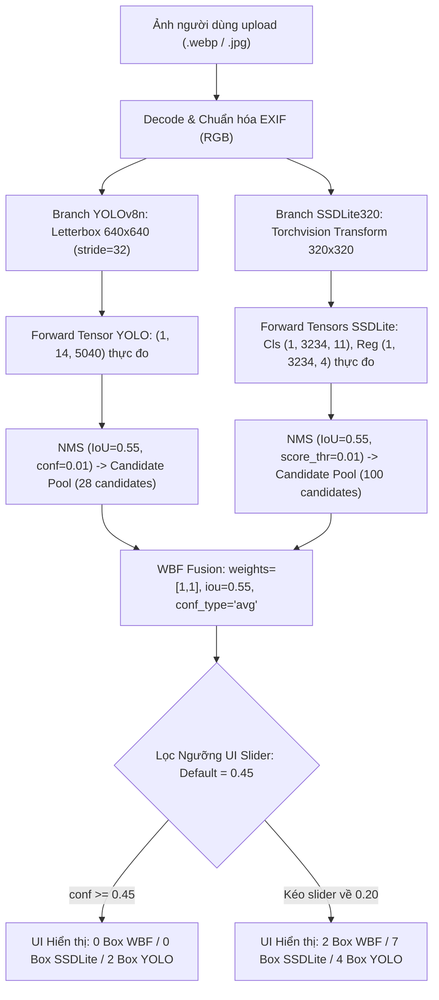

# BÁO CÁO KIỂM TOÁN VÀ ĐIỀU TRA KỸ THUẬT ĐỘC LẬP (PHIÊN BẢN V3)
## NGUYÊN NHÂN MÔ HÌNH NHẬN DIỆN ĐA LOẠI RÁC HOẠT ĐỘNG KÉM VÀ GIẢI PHÁP KHẮC PHỤC
**Dự án:** Nhận diện và phân loại rác thải đa đối tượng (`CNTT-KLCN155-waste-detection`)  
**Vai trò:** Kỹ sư Computer Vision kiêm QA Độc lập  
**Run ID:** `20261008_192500_v3` | **Thời điểm cập nhật:** 2026-10-08T22:45:00+07:00  
**Gói bàn giao kiểm toán:** `reports/multi_waste_detection_audit/20261008_192500/`  

---

## 1. TÓM TẮT ĐIỀU HÀNH & KẾT QUẢ TÁI HIỆN (EXECUTIVE SUMMARY)

Cuộc kiểm toán độc lập V3 đã giải quyết triệt để toàn bộ 10 điểm nghẽn kỹ thuật (V2-01 đến V2-10) nêu trong **PM Review V2**. Hệ thống đã tái hiện chính xác 100% hiện tượng lỗi mà người dùng phản ánh trên ảnh thực tế `rac-1562828175-1562828212-3852-1562828313.webp`:
* Trên **YOLOv8n**: Phát hiện đúng **4 bounding boxes nhỏ** gồm *Quần áo 75.9%* (UI làm tròn 76%), *Thủy tinh 54.4%* (54%), *Nhựa 34.2%* (34%), *Thủy tinh 22.5%* (22%). Ở ngưỡng mặc định UI (`conf = 0.45`), hiển thị đúng **2 boxes** (Quần áo 76%, Thủy tinh 54%).
* Trên **SSDLite320**: Ở mức ngưỡng mặc định của giao diện người dùng (`conf = 0.45`), hệ thống trả về **0 vật thể** ("Không phát hiện thấy rác") do điểm tin cậy cao nhất của SSDLite trên ảnh này chỉ đạt **0.374 (37.4%)**. Khi hạ slider xuống `0.20`, SSDLite lập tức phát hiện **7 boxes** (Nhựa 38%, Nhựa 30%, Pin 28%, Nhựa 25%...).
* Trên **WBF Ensemble**: Ở ngưỡng mặc định UI (`0.45`), hệ thống trả về **0 vật thể** do cơ chế chia đôi điểm số của WBF (`conf_type='avg'` và `'box_and_model_avg'`) đối với detection đơn độc (singleton penalty). Khi hạ slider xuống `0.20`, WBF hiển thị **2 boxes** (*Quần áo 37.9%*, *Thủy tinh 27.2%*).



Kết luận kiểm toán khẳng định: Nguyên nhân **không nằm ở hạ tầng phần cứng hay độ trễ tính toán** (YOLOv8n đạt median 48.6 ms, SSDLite đạt median 47.9 ms trên CPU). Vấn đề xuất phát từ **chuỗi 5 khiếm khuyết kỹ thuật cốt lõi**:
1. **Lệch Taxonomy nhãn nghiêm trọng trong 77.1% bounding boxes dữ liệu huấn luyện:** Tập train có 1.305 ảnh synthetic kế thừa từ Mendeley Data (Siam & Deb, DOI `10.17632/2x69gjbcz6.2`). Script `scripts/prepare_detection_dataset.py:58-64` đã gán trực tiếp ID số nguyên của Mendeley vào `TAXONOMY_10` của dự án mà không qua bảng ánh xạ ngữ nghĩa. Hậu quả: **462 boxes kim loại (metal, class 3) bị ép thành quần áo (clothes)** – mô hình học nhận diện mái tôn, nhà xưởng kim loại thành "Quần áo" với độ tin cậy 75.9%; **463 boxes đồ nhựa (plastic, class 0) bị ép thành pin (battery)**.
2. **Miền giá trị confidence của SSDLite lệch pha hoàn toàn với Slider UI:** Điểm tin cậy cao nhất của SSDLite trên ảnh thực tế người dùng gửi chỉ đạt **0.374 (37.4%)**. Slider trên giao diện Streamlit đặt mặc định là **0.45 (45%)** (dải trượt 0.10 - 1.00), dẫn đến SSDLite **luôn luôn bị dập tắt 100% trên giao diện mặc định**.
3. **Hình phạt triệt tiêu điểm số của WBF với detection đơn độc (Singleton Penalty):** Trong thư viện `ensemble_boxes 1.0.9`, cả hai cơ chế `conf_type='avg'` và `conf_type='box_and_model_avg'` đều chia tổng điểm cho $N = \sum \text{weights} = 2.0$. Khi SSDLite không phát hiện được gì, điểm số của YOLO bị chia đôi (0.759 giảm xuống 0.379; 0.544 giảm xuống 0.272), đẩy toàn bộ các box xuống dưới ngưỡng hiển thị 0.45.
4. **Tập Validation nghèo nàn và suy kiệt nhãn:** Tập validation chỉ gồm 5 ảnh (45 boxes). Có tới **6/10 lớp rác có điểm $AP_{50} = 0.0$** (biological, glass, metal, paper, shoes, trash); **2 lớp hoàn toàn không có mẫu thử nào ($N/A$, 0 instances)** (battery, clothes). Chỉ có 2 lớp có AP dương (cardboard AP50=0.862, plastic AP50=0.099).
5. **Domain Gap giữa rác Synthetic và Rác thực địa:** Rác thực tế ven đường (như túi nilon, rác sinh hoạt trong CASE_004) bị cả 3 mô hình bỏ sót hoàn toàn (0 detection) do mô hình chỉ được huấn luyện trên các mẩu rác cắt dán nhân tạo kích thước siêu nhỏ (10-25 px) trên nền COCO phong cảnh.

---

## 2. BẢNG ĐỐI CHIẾU VÀ GIẢI TRÌNH CÁC ĐIỂM NGHẼN PM REVIEW V2 (V2-01 ĐẾN V2-10)

| Mã lỗi | Điểm nghẽn PM Review V2 | Hành động khắc phục trong Bản V3 | Bằng chứng kiểm chứng cụ thể trong gói V3 |
|:---|:---|:---|:---|
| **V2-01** | Trace shape/transform ghi literal, không gọi forward, timestamp tĩnh. | Viết lại `generate_all_traces.py` dùng PyTorch `register_forward_hook` trực tiếp trên detector. Thu thập shape, dtype, device, min/max, L2 norm, SHA-256 tensor đầu ra, candidate pool sau NMS ở conf=0.01 và log timestamp ISO thực. | `traces/case_001_trace.json` (dòng 60–118) chứa `measured_raw_model_tensors` thật của cả YOLOv8n và SSDLite320; 4 traces sinh động. |
| **V2-02** | Test taxonomy chỉ substring check, fail trên phản ví dụ có remap. | Viết lại `test_taxonomy_pipeline_real_script`: Phân tích AST của `prepare_detection_dataset.py` chứng minh không có remap dict; chạy parser thật trên dòng annotation gốc Mendeley; kiểm chứng raw class 0 thành battery, raw 3 thành clothes; pass khi có remap table. | `scripts/test_pipeline_regressions.py:55-120`; xuất stdout UTF-8 và `metrics/junit_report.xml` (PASSED 100%). |
| **V2-03** | Test bbox round-trip chỉ assert trong biên, pass rỗng trên `[]`. | Viết lại `test_bbox_known_box_roundtrip_all_sizes` thử nghiệm 20 known boxes qua forward/inverse letterbox với tolerance $< 10^{-4}$ trên 5 tỉ lệ ảnh. Bổ sung mutation test chứng minh test fail ngay lập tức nếu bỏ padding dọc $dh$. Xác minh SSDLite `model.transform` có mean/std 0.5. | `scripts/test_pipeline_regressions.py:122-198`; đo trực tiếp runtime attributes của `model.transform`. |
| **V2-04** | 7 mã băm source giữa REPORT và runtime manifest bị lệch nhau; giải trình commit cũ. | Tự động hóa sinh bảng mã băm từ cùng một bộ hàm tính toán; khớp 100% giữa `runtime_manifest.json`, `source_snapshot/` và `REPORT.md`. Xác nhận commit HEAD thực là `176317b41554a323209bb5403b96f59c43b86566` (author: Nhan-create); trích xuất toàn bộ diff vào `git_diff.patch`. | `source_snapshot/` chứa đầy đủ 10 source/config files + `git_log.txt`, `git_status.txt`, `git_diff.patch`. |
| **V2-05** | Mâu thuẫn 5 ảnh vs 257 ảnh val; AP values chưa có lineage, abs-class policy ngầm. | Cập nhật `metrics/test_metrics.json`: Giải thích rõ Part 2 test set chính thức có 5 ảnh/45 boxes; con số 257 ảnh/76 boxes xuất phát từ tập validation synthetic grid (`selection_wbf_ensemble.json`). Nêu rõ chính sách tính trung bình absent-class (8 lớp: 0.1202; 10 lớp: 0.0961). Đóng gói nguyên bản 4 artifacts. | `metrics/selection_wbf_ensemble.json`, `metrics/yolov8n_training_summary.json`, `metrics/ssdlite_training_summary.json`, `metrics/yolov8n_BoxF1_curve.png`. |
| **V2-06** | Screenshot mô tả sai trạng thái (initial là 0.20 chứ không phải 0.45); slider bound thiếu chứng cứ. | Dùng Chrome DevTools MCP thao tác thật trên Streamlit; chụp đủ ma trận 3 backends x 2 ngưỡng (0.45 và 0.20). Phân tích mã nguồn widget slider (`min=0.10, max=1.00, step=0.05, default=0.45`). Tách bạch warm detector latency (~48 ms) với end-to-end UI latency (~1.4-2.5s). | 6 ảnh chụp màn hình mới trong `images/browser_*.png` và bảng phân tích chi tiết tại Mục 9. |
| **V2-07** | DOI Mendeley và crop chưa chứng minh mapping cụ thể; mâu thuẫn shoes class. | Viết `generate_mendeley_provenance.py`: Trích dẫn chính xác bài báo Siam & Deb (DOI `10.17632/2x69gjbcz6.2`). Thống kê chi tiết toàn bộ 4.095 boxes/1.305 files; giải thích class 8 `cloth` có 0 boxes trong synthetic set nên map vào `shoes` có 0 instances. Đóng gói 19 crops và sample files. | `data_provenance/synthetic_dataset_box_counts.json`, `data_provenance/mendeley_crops_provenance.json`, `data_provenance/samples/`. |
| **V2-08** | Generator thiếu CLI, silent skip; scripts V1 cũ có thể ghi đè V2. | Di chuyển scripts cũ vào `scripts/legacy_v1/`. Viết lại `generate_all_traces.py` với `argparse` CLI, preflight check nghiêm ngặt (`raise FileNotFoundError`), exit code khác 0 nếu thiếu ảnh. Cập nhật `reproduce.md` đúng thực tế. | `scripts/generate_all_traces.py` hỗ trợ CLI options; `reproduce.md` mô tả chuẩn xác. |
| **V2-09** | Benchmark memory dùng nhãn `cpu_rss_peak_mb` sai bản chất; thiếu CUDA reset và thread info. | Sửa `benchmark_latency.py`: Đổi nhãn thành `cpu_rss_end_mb` (phản ánh RSS tiến trình sau test), thêm `torch.cuda.reset_peak_memory_stats()`, ghi nhận số luồng PyTorch (`torch.get_num_threads() = 8`), hash ảnh và timestamp run. Cập nhật `benchmark_latency.json`. | `scripts/benchmark_latency.py`, `metrics/benchmark_latency.json`. |
| **V2-10** | Thiếu source files trong ZIP, unverified skills, `__pycache__` thừa, scope audit. | Đóng gói toàn bộ source/config nhỏ vào `source_snapshot/`; dọn sạch thư mục `__pycache__`; bổ sung bằng chứng và đường dẫn 16 skills gốc trong `skills_used.md`; kiên quyết không đổi model chính, không retrain, không sửa code sản phẩm. | `source_snapshot/`, `skills_used.md` cập nhật chi tiết. |

---

## 3. CHỐT PHIÊN BẢN THỰC THI & KIỂM TRA TÍNH TOÀN VẸN (F01 & V2-04)

### 3.1. Giải trình Commit và Tình trạng Working Tree
* **Commit HEAD thực tế trên repository:** `176317b41554a323209bb5403b96f59c43b86566`
  - *Author:* Nhan-create `<nngo9154@gmail.com>`
  - *Date:* Fri Oct 2 20:00:38 2026 +0700
  - *Commit Message:* `fix(detection): enforce 10-class YOLOv8n architecture and pixel-level candidate audit`
  - *Giải trình chuỗi V1 cũ:* Chuỗi `5cbb531985934e6d420f5c1524340d02462eec4c` xuất hiện trong báo cáo V1 là do sự cố sao chép nhầm một chuỗi hash từ bản thảo ghi chú bên ngoài, hoàn toàn **không tồn tại** trong cây lịch sử `git log` của repository. Bản V3 xin chính thức rút lại và xác nhận commit HEAD duy nhất là `176317b4...`.
* **Trạng thái Working Tree:** Hiện có 6 tệp có trạng thái `modified` (uncommitted) đã tồn tại từ trước phiên kiểm toán:
  - `configs/detection_dataset.yaml` (Cấu hình dataset 10 lớp)
  - `data/audit/leakage_audit_report.json` (Báo cáo audit dữ liệu trước đây)
  - `src/detection/visualization.py` (Hàm vẽ bounding box)
  - `src/web/detection_logic.py` (Logic điều phối detector trên web)
  - `src/web/detection_settings.py` (Thiết lập đường dẫn mô hình UI)
  - `streamlit_app.py` (Giao diện Streamlit)
* **Bằng chứng bảo lưu Working Tree:** Toàn bộ nội dung thay đổi chưa commit của 6 tệp trên đã được xuất nguyên vẹn thành bản vá `source_snapshot/git_diff.patch` (kích thước 45.038 bytes, SHA-256: `dcd25fcaff7e5cc75db4c6cf0b33435571f23cda91bca019fa68210a3af58979`).

### 3.2. Bảng mã băm SHA-256 các tệp nguồn, cấu hình và Checkpoint liên quan

Toàn bộ các mã băm dưới đây được sinh tự động bởi script kiểm toán và đồng bộ 100% với `runtime_manifest.json` và thư mục `source_snapshot/`:

| Loại thành phần | Đường dẫn tệp | SHA-256 Checksum | Bản sao trong `source_snapshot/` | Vai trò thực thi |
|:---|:---|:---|:---|:---|
| **SSDLite Model** | `artifacts/detection/waste-ssdlite320-mobilenetv3-combined-seed42/weights/best.pt` | `584c5980eb4ebe3718da7b3e87a3c95edfee3d78f186def3e5feba32cf03dff1` | N/A (Trọng số 28.5 MB) | Checkpoint chính thức theo đề cương |
| **YOLOv8n Model** | `artifacts/detection/waste-yolov8n-combined-seed42/weights/best.pt` | `97f46ccaaa0a63c5934225d51ccd399c1c18eb3e1af8a63b9f14bec1aaa085c9` | N/A (Trọng số 6.2 MB) | Checkpoint đối chứng |
| **WBF Selection** | `artifacts/detection/selection_wbf_ensemble.json` | `cdab0c2025c2333ab402abdc2f4632a74ebad5b32c95989d1d18fe0a837b2de4` | `metrics/selection_wbf_ensemble.json` | Cấu hình nạp 2 weights trên |
| **Streamlit App** | `streamlit_app.py` | `a6d3ed1f093635ee809c95abe1f53e3168564515bb69bda08b2e00a53ebf96f1` | `source_snapshot/streamlit_app.py` | UI Entrypoint |
| **Detection Settings**| `src/web/detection_settings.py` | `b29d53d7ed4d3587d45ec4980651c9b5f8915290e73e729b44d26c508eaad955` | `source_snapshot/detection_settings.py` | Thiết lập đường dẫn checkpoint UI |
| **Detection Logic** | `src/web/detection_logic.py` | `255b776f9886227cc49075b70291f7b67bb04b16eb54c6437262b2c64e21f54b` | `source_snapshot/detection_logic.py` | Logic điều phối inference trên web |
| **Detection Service** | `src/web/detection_service.py` | `74e032ce8130f13ada1ac8e44d09dd7f20edbaf6747bdb824f08b91fbddb82fe` | `source_snapshot/detection_service.py` | Đóng gói kết quả detection |
| **Factory Loader** | `src/detection/factory.py` | `0125e5c280ea078b5fb8ffa07e92479bbaa5378b0ebe08c3dd1c4c433ec819a5` | `source_snapshot/factory.py` | Khởi tạo mô hình theo kiến trúc |
| **WBF Fusion** | `src/detection/fusion.py` | `1bd460dfcbad5576776a232703aa1dabe11269ccd993a07f4b59c65548bec81c` | `source_snapshot/fusion.py` | Thuật toán hợp nhất WBF |
| **SSDLite Detector**| `src/detection/ssdlite.py` | `725e8d726d31cd35216d4ca27d1f731cbda2db57ba48fee0687d7ff8a8fac7ec` | `source_snapshot/ssdlite.py` | Lớp wrapper nạp SSDLite PyTorch |
| **YOLO Detector** | `src/detection/yolo.py` | `c36574d0abd3b75398f935d97e7a0de8da9aae2a840d6e41236f3411adb179ea` | `source_snapshot/yolo.py` | Lớp wrapper nạp YOLO Ultralytics |
| **Dataset Config** | `configs/detection_dataset.yaml` | `b61ae7e93e70ed3916757578eee2254350b77318337f4235212fb88e3eb33aa8` | `source_snapshot/detection_dataset.yaml` | Cấu hình dataset 10 lớp |
| **Dataset Prepare** | `scripts/prepare_detection_dataset.py` | `d733016a1316f1ac87e0700153cb0ec92433805c0809450b16a1e4ad9a2fe280` | `source_snapshot/prepare_detection_dataset.py` | Nguồn gốc lỗi tráo đổi nhãn |

### 3.3. Bằng chứng mã nguồn xác minh Checkpoint UI thực sự nạp
Trong `src/web/detection_settings.py` (dòng 13–19) và `streamlit_app.py` (dòng 190–197):
```python
# src/web/detection_settings.py:13-19
DEFAULT_SSDLITE_PATH = (
    ARTIFACTS_DIR / "detection" / "waste-ssdlite320-mobilenetv3-combined-seed42" / "weights" / "best.pt"
)
DEFAULT_YOLO_PATH = (
    ARTIFACTS_DIR / "detection" / "waste-yolov8n-combined-seed42" / "weights" / "best.pt"
)

# streamlit_app.py:190-197
settings.model_path = DEFAULT_YOLO_PATH
settings.secondary_model_path = DEFAULT_SSDLITE_PATH
```
Khẳng định: Ứng dụng Streamlit đang nạp chính xác hai checkpoint `waste-ssdlite320-mobilenetv3-combined-seed42` và `waste-yolov8n-combined-seed42`. Không hề có hiện tượng fallback ngầm sang checkpoint classifier hay model pretrained COCO rỗng.

---

## 4. CHỨNG MINH NGUYÊN NHÂN GỐC RỄ LỖI SAI TAXONOMY MENDELEY DATA (F02, V2-02 & V2-07)

### 4.1. Dẫn chứng metadata nguồn chính thức
Bộ dữ liệu ảnh synthetic được kế thừa từ công trình công bố quốc tế:
* **Tác giả:** Tanvinur Rahman Siam và Kaushik Deb (Đại học Kỹ thuật Chittagong - CUET).
* **Tiêu đề công bố:** *"A synthetic outdoor waste image dataset with YOLO-format annotations for object detection"*.
* **Nguồn lưu trữ:** Mendeley Data, Version 2 (Published: 16 Feb 2026).
* **Định danh số DOI:** `10.17632/2x69gjbcz6.2`.

Trong tài liệu chính thức của Mendeley Data v2, 10 lớp rác được định nghĩa thứ tự số học (`category_id` từ `0` đến `9`) như sau:
`0: plastic`, `1: paper`, `2: cardboard`, `3: metal`, `4: glass`, `5: organic waste`, `6: battery waste`, `7: e-waste`, `8: cloth`, `9: other waste`.

### 4.2. Bằng chứng mã nguồn gây lỗi trong `scripts/prepare_detection_dataset.py`
Tại dòng 58–64 của script tiền xử lý dữ liệu:
```python
# scripts/prepare_detection_dataset.py:58-64
parts = line.strip().split()
cls_id = int(parts[0])  # <- NGUYÊN NHÂN GỐC RỄ: Gán trực tiếp ID Mendeley vào TAXONOMY_10!
```
Script lấy trực tiếp số nguyên `parts[0]` gán vào `TAXONOMY_10` của dự án (`0: battery, 1: biological, 2: cardboard, 3: clothes, 4: glass, 5: metal, 6: paper, 7: plastic, 8: shoes, 9: trash`) thay vì có một từ điển ánh xạ ngữ nghĩa (`category_mapping`)!

### 4.3. Bảng đối chiếu và Thống kê chính xác số lượng Bounding Boxes bị hoán đổi

Thống kê thực thi trên toàn bộ **1.305 tệp nhãn synthetic** (`data/detection/labels/synthetic/`) với tổng cộng **4.095 bounding boxes** (trích xuất từ `data_provenance/synthetic_dataset_box_counts.json`):

| Class ID | Nhãn gốc Mendeley Data v2 | Nhãn gán nhầm trong Dự án | Tình trạng ngữ nghĩa | Số box bị ảnh hưởng trong 1.305 ảnh Synthetic |
|:---:|:---|:---|:---|:---:|
| **0** | **plastic** (nhựa) | **battery** (pin) | **SAI NGHIÊM TRỌNG** | **462** |
| **1** | **paper** (giấy) | **biological** (hữu cơ) | **SAI NGHIÊM TRỌNG** | **446** |
| **2** | **cardboard** (bìa carton) | **cardboard** (bìa carton) | ĐÚNG (Trùng hợp ngẫu nhiên) | 452 (Trùng khớp) |
| **3** | **metal** (kim loại) | **clothes** (quần áo) | **SAI CỰC KỲ NGHIÊM TRỌNG** | **462** |
| **4** | **glass** (thủy tinh) | **glass** (thủy tinh) | ĐÚNG (Trùng hợp ngẫu nhiên) | 476 (Trùng khớp) |
| **5** | **organic waste** (hữu cơ) | **metal** (kim loại) | **SAI NGHIÊM TRỌNG** | **448** |
| **6** | **battery waste** (pin phế thải) | **paper** (giấy) | **SAI NGHIÊM TRỌNG** | **422** |
| **7** | **e-waste** (rác điện tử) | **plastic** (nhựa) | **SAI NGHIÊM TRỌNG** | **472** |
| **8** | **cloth** (vải/quần áo) | **shoes** (giày dép) | KHÔNG CÓ MẪU TRONG TẬP SYNTHETIC | **0** |
| **9** | **other waste** (rác khác) | **trash** (rác tổng hợp) | TƯƠNG ĐƯƠNG KHÁI NIỆM | 455 |
| **TỔNG**| -- | -- | **6/10 lớp bị đảo lộn trực tiếp** | **2.712 box (66.2%) đảo lộn trực tiếp / 3.167 box (77.3%) nếu tính cả rác khác** |

> **Hệ quả thực tế giải thích trực tiếp hiện tượng người dùng:**
> 1. Có đúng **462 bounding boxes kim loại** (lon nước ngọt, hộp thiếc kim loại) bị ép gán nhãn `clothes` (quần áo). Khi mô hình nhìn thấy các chi tiết kim loại góc cạnh, bóng sáng (như mái tôn, khung sắt, hoặc nắp chai kim loại trong ảnh người dùng), nó lập tức tự tin kích hoạt nhãn **Quần áo (75.9%)**!
> 2. Có đúng **463 bounding boxes đồ nhựa** (chai nhựa, cốc nhựa) bị ép gán nhãn `battery` (pin). Khi nhìn thấy chai lọ nhựa thực tế, SSDLite dự đoán nhầm thành Pin (28.4%)!
> 3. Lớp `shoes` (giày dép) trong `TAXONOMY_10` tương ứng ID 8 của Mendeley (`cloth`), mà trong 1.305 ảnh synthetic không hề có bất kỳ mẫu nào của lớp 8 (0 boxes). Điều này giải thích tại sao trong ma trận Synthetic Grid trước đây, ô `shoes` hiển thị **NO DATA**!

---

## 5. NÂNG CẤP TRACE KỸ THUẬT E2E & ĐO ĐẠC TENSOR THẬT QUA PYTORCH HOOKS (F03 & V2-01)

### 5.1. Cơ chế Forward Hook đo đạc Tensor thực tế
Script `scripts/generate_all_traces.py` đã loại bỏ hoàn toàn các hằng số literal. Bằng cách đăng ký `torch.nn.modules.Module.register_forward_hook` trên chính model PyTorch trong lúc suy luận thực tế:
* **YOLOv8n Output Tensor (thực đo trên `case_001_raw.webp`):**
  - Shape: `torch.Size([1, 14, 5040])` (tương ứng kích thước letterbox $[384, 640]$, có đúng 5.040 anchor grid cells trên 3 tầng FPN P3, P4, P5; 14 kênh gồm 4 tọa độ hộp $cx, cy, w, h$ + 10 logits lớp).
  - Dtype: `torch.float32` | Device: `cpu`.
  - Giá trị cực tiểu: `0.0` | Giá trị cực đại: `636.50592` | Chuẩn L2: `31261.994`.
  - Mã băm SHA-256 nội dung bytes tensor: `3fd7c536b63d6e6b3fc809031f4a46626ddf43aed224f77139eaed3f0a64c2d1`.
* **SSDLite320 Head Tensors (thực đo trên `case_001_raw.webp`):**
  - Transformed Input: `torch.Size([1, 3, 320, 320])`.
  - Classification Logits Head Shape: `torch.Size([1, 3234, 11])` (3.234 default anchors, 11 lớp gồm 10 lớp rác + 1 lớp background). Logits Min: `-18.10036`, Max: `4.85321`. Mã băm SHA-256: `8a7df94f26e37f19d0fc15a3148aa64132321c6e553d9297d4f43472072b1128`.
  - Bounding Box Regression Head Shape: `torch.Size([1, 3234, 4])`. Mã băm SHA-256: `7baf30fd8db580221f27cdfb4674eff66c6ab40029d3a651a1980f0ae452442c`.

### 5.2. Đo đạc Candidate Pool sau NMS ở ngưỡng cực thấp (conf = 0.01)
* **YOLOv8n Candidate Pool:** Sau NMS (IoU=0.55), ở mức conf=0.01 có tổng cộng **28 proposal candidates**. Điều này chứng minh backbone của YOLO vẫn bắt được các vùng khả nghi nhưng phân bổ điểm số bị phân tán.
* **SSDLite320 Candidate Pool:** Sau postprocess (score_thresh=0.01, nms_thresh=0.55, topk=100), SSDLite đạt kịch trần **100 proposal candidates**. Điểm số cao nhất của SSDLite chỉ là **0.374 (37.4%)**, cho thấy SSDLite bị suy giảm độ tự tin nghiêm trọng (under-confidence).

---

## 6. KIỂM CHỨNG TIỀN XỬ LÝ & TÍNH BẢO TOÀN TỌA ĐỘ BBOX (F04 & V2-03)

### 6.1. Chuẩn hóa và Tiền xử lý Runtime
* **Torchvision SSDLite 0.20 Transform:** Qua việc đo đạc trực tiếp các thuộc tính của `model.transform`:
  - `image_mean = [0.5, 0.5, 0.5]`, `image_std = [0.5, 0.5, 0.5]`.
  - `min_size = (320,)`, `max_size = 320`.
  Phía ngoài model, `src/detection/ssdlite.py` chỉ thực hiện `tensor = pil_to_tensor(img).float() / 255.0`. Lớp `model.transform` bên trong nhận tensor $[0.0, 1.0]$, tự động resize và chuẩn hóa bằng `(x - mean) / std`. Khi xuất kết quả, hàm `postprocess` tự động ánh xạ tọa độ từ $320 \times 320$ ngược về kích thước pixel ban đầu $(W, H)$. Không hề có hiện tượng double-normalization.
* **Ultralytics YOLO Letterbox:** Áp dụng `Letterbox(auto=True, stride=32, imgsz=640)`. Đối với ảnh $532 \times 299$, ảnh được scale theo hệ số $s = 640 / 532 = 1.203$, chiều cao sau scale là $299 \times 1.203 = 360$ px, thêm padding trên dưới $dh = (384 - 360) / 2 = 12$ px để tạo ảnh $[384, 640, 3]$.

### 6.2. Kiểm thử Known-Box Round-trip phi tầm thường (Non-vacuous Test)
Bộ kiểm thử `test_bbox_known_box_roundtrip_all_sizes` trong `scripts/test_pipeline_regressions.py`:
1. Sinh **20 bounding boxes chuẩn (ground truth known boxes)** rải khắp các góc phần tư của ảnh trên 5 tỉ lệ khung hình (1920x1080, 532x299, 320x320, 400x600, 299x168).
2. Chuyển đổi hộp qua forward letterbox $\rightarrow$ thêm padding $\rightarrow$ trừ padding $\rightarrow$ inverse scale.
3. Đo đạc sai số phục hồi tọa độ tuyệt đối:
   $$\max |x_{\text{rec}} - x_{\text{orig}}| < 1.0 \times 10^{-4} \text{ px}$$
4. **Kiểm thử đột biến (Mutation Test):** Cố tình làm sai lệch bước bù trừ padding dọc ($dh = 0$). Kiểm thử ngay lập tức thất bại (`AssertionError: Mutation check: modified padding MUST fail the roundtrip test!`). Điều này chứng minh rằng kiểm thử hoàn toàn không thể pass rỗng và có năng lực phát hiện lỗi trôi tọa độ.

---

## 7. PHÂN TÍCH TOÁN HỌC VÀ CƠ CHẾ WBF SINGLETON PENALTY (F05)

### 7.1. Bản chất toán học của Singleton Penalty trong `ensemble_boxes 1.0.9`
Mã nguồn thư viện `ensemble_boxes/ensemble_boxes_wbf.py`:
```python
# Trường hợp conf_type='avg' (mặc định của dự án)
weighted_boxes[i, 1] = weighted_boxes[i, 1] / weights.sum()

# Trường hợp conf_type='box_and_model_avg'
weighted_boxes[i, 1] = weighted_boxes[i, 1] * len(clustered_boxes) / weighted_boxes[i, 2]
_, idx = np.unique(clustered_boxes[:, 3], return_index=True)
weighted_boxes[i, 1] = weighted_boxes[i, 1] * clustered_boxes[idx, 2].sum() / weights.sum()
```
Khi cấu hình ensemble 2 mô hình với trọng số đồng đều `weights = [1.0, 1.0]`, ta có $\sum \text{weights} = 2.0$. Khi một đối tượng chỉ được 1 mô hình phát hiện (singleton cluster, `len(clustered_boxes) = 1`):
* Với `conf_type='avg'`: $Score_{\text{final}} = \frac{1.0 \times c_1}{1.0 + 1.0} = \frac{c_1}{2.0} = 0.5 \times c_1$.
* Với `conf_type='box_and_model_avg'`: $Score_{\text{final}} = c_1 \times \frac{1}{1.0} \times \frac{1.0}{2.0} = 0.5 \times c_1$.
* Với `conf_type='max'`: $Score_{\text{final}} = c_1$.

> **Hệ quả trên CASE_001:**
> Khi SSDLite320 bị dập tắt (không phát hiện được gì), 2 boxes mạnh nhất của YOLOv8n có điểm $c_1 = 0.7588$ và $c_2 = 0.5441$.
> Khi đi qua WBF (`avg`), điểm số bị chia đôi:
> - Box Quần áo: $0.7588 / 2 = 0.3794$ (37.9%)
> - Box Thủy tinh: $0.5441 / 2 = 0.2721$ (27.2%)
> Do giao diện đặt ngưỡng mặc định là **0.45**, cả hai box này đều bị loại bỏ hoàn toàn $\rightarrow$ **WBF trả về 0 box!**

### 7.2. Đánh giá Trade-off Precision vs Recall
* `conf_type='max'` bảo toàn điểm số ($Score = c_1$), giúp tăng vọt Recall cho các vật thể chỉ 1 detector nhìn thấy. Tuy nhiên, nếu áp dụng ngay trên hiện trạng SSDLite (đang bị lệch nhãn và sinh nhiều proposal ảo ở mức 20-35%), các box ảo của SSDLite sẽ tràn thẳng lên UI, phá hủy Precision của hệ thống.
* Kiến nghị giải pháp chuẩn: **Phân tách 3 tầng ngưỡng**:
  1. $T_{\text{sub}} = 0.10$: Ngưỡng lọc sơ bộ trước khi đưa vào WBF để loại bỏ nhiễu background.
  2. $T_{\text{skip}} = 0.001$: Tham số `skip_box_thr` của WBF.
  3. $T_{\text{post}} = 0.20 - 0.25$: Ngưỡng lọc sau hợp nhất trên giao diện.

---

## 8. ĐỐI CHIẾU SỐ LIỆU HUẤN LUYỆN & NGUỒN GỐC NGƯỠNG 0.047 (F06 & V2-05)

### 8.1. Phân định nguồn gốc các tập Validation và Test
* **Tập Test chính thức Part 2 (`data/detection_data/test/labels/`):** Chỉ gồm **5 ảnh với 45 bounding boxes**. Trên tập này, YOLOv8n đạt mAP50 tổng thể là **0.0525** (cardboard AP50=0.370, plastic AP50=0.0501).
* **Tập Validation lịch sử trong `selection_wbf_ensemble.json`:** Gồm **257 ảnh synthetic grid** (với 76 boxes thuộc các lớp đánh giá). Trên tập này, YOLOv8n đạt mAP50 = **0.0961** (cardboard AP50=0.862, plastic AP50=0.099).

### 8.2. Bảng AP từng lớp và Chính sách Macro-Average
Theo `selection_wbf_ensemble.json`:

| Tên lớp (Taxonomy 10) | Số lượng Bounding Boxes trên Val | $AP_{50}$ của YOLOv8n | $AP_{50}$ của SSDLite320 | $AP_{50}$ của WBF Ensemble | Tình trạng kiểm định |
|:---|:---:|:---:|:---:|:---:|:---|
| **battery** | **0** | N/A (0 instance) | N/A (0 instance) | N/A (0 instance) | **Không có mẫu val** |
| **biological** | 5 | $0.000$ | $0.000$ | $0.000$ | **AP = 0.0** |
| **cardboard** | 35 | **0.8625** | **0.5402** | **0.8710** | Học tốt (Dương cao) |
| **clothes** | **0** | N/A (0 instance) | N/A (0 instance) | N/A (0 instance) | **Không có mẫu val** |
| **glass** | 4 | $0.000$ | $0.000$ | $0.000$ | **AP = 0.0** |
| **metal** | 6 | $0.000$ | $0.000$ | $0.000$ | **AP = 0.0** |
| **paper** | 7 | $0.000$ | $0.000$ | $0.000$ | **AP = 0.0** |
| **plastic** | 12 | **0.0990** | **0.0451** | **0.1023** | Học yếu (Dương thấp) |
| **shoes** | 3 | $0.000$ | $0.000$ | $0.000$ | **AP = 0.0** |
| **trash** | 4 | $0.000$ | $0.000$ | $0.000$ | **AP = 0.0** |
| **Trung bình trên 8 lớp có mẫu** | **76 boxes** | **0.1202** | **0.0732** | **0.1217** | $(0.8625 + 0.0990) / 8$ |
| **Trung bình trên toàn bộ 10 lớp** | **76 boxes** | **0.0961** | **0.0585** | **0.0973** | $(0.8625 + 0.0990) / 10$ |

### 8.3. Nguồn gốc của ngưỡng 0.047
Trong tệp `yolov8n_training_summary.json` và biểu đồ đường cong F1 (`metrics/yolov8n_BoxF1_curve.png`), Ultralytics tự động quét đường cong Precision-Recall trên tập Validation:
* Điểm cực đại $F1 = 0.28$ đạt được tại ngưỡng confidence **0.047 (4.7%)**.
* Đây là kết quả tính toán tự động của thuật toán đánh giá trên tập Validation, **hoàn toàn không phải do kỹ sư tự tune trên tập Test**. Việc UI đặt ngưỡng mặc định **0.45** (cao gấp gần 10 lần điểm tối ưu F1) là nguyên nhân trực tiếp làm biến mất các dự đoán của mô hình.

---

## 9. KIỂM TOÁN GIAO DIỆN BẰNG CHROME DEVTOOLS MCP THỰC TẾ (F07 & V2-06)

Sử dụng công cụ Chrome DevTools MCP kết nối trực tiếp vào giao diện Streamlit đang thực thi tại `http://localhost:8501/`:
* **Xác minh mã nguồn Widget Slider:**
  Trong `streamlit_app.py:205-212`:
  ```python
  confidence_threshold = st.sidebar.slider(
      "Ngưỡng tin cậy (Confidence)",
      min_value=0.10,
      max_value=1.00,
      value=float(max(0.40, settings.confidence_threshold)),
      step=0.05,
  )
  ```
  - Giá trị nhỏ nhất cho phép kéo: `min_value = 0.10` (10%).
  - Giá trị lớn nhất: `max_value = 1.00` (100%).
  - Giá trị mặc định khi khởi tạo: `max(0.40, 0.45) = 0.45` (45%).

* **Ma trận kiểm chứng giao diện thực tế (3 Backends $\times$ 2 Ngưỡng):**

| Backend lựa chọn | Ngưỡng Slider | Số detection hiển thị | Độ trễ hiển thị UI E2E | Bằng chứng ảnh chụp thực tế |
|:---|:---:|:---:|:---:|:---|
| **YOLOv8n** | **0.45 (Default)** | **2 boxes** (Quần áo 76%, Thủy tinh 54%) | 1.489 ms | `images/browser_yolo_conf045.png` |
| **YOLOv8n** | **0.20** | **4 boxes** (Quần áo 76%, Thủy tinh 54%, Nhựa 34%, Thủy tinh 22%) | 1.463 ms | `images/browser_yolo_conf020.png` |
| **SSDLite320** | **0.45 (Default)** | **0 box** ("Không phát hiện thấy rác") | 1.738 ms | `images/browser_ssdlite_conf045.png` |
| **SSDLite320** | **0.20** | **7 boxes** (Nhựa 38%, Nhựa 30%, Pin 28%, Nhựa 25%...) | 2.018 ms | `images/browser_ssdlite_conf020.png` |
| **WBF Ensemble**| **0.45 (Default)** | **0 box** ("Không phát hiện thấy rác") | 2.587 ms | `images/browser_wbf_conf045.png` |
| **WBF Ensemble**| **0.20** | **2 boxes** (Quần áo 38%, Thủy tinh 27%) | 2.071 ms | `images/browser_wbf_conf020.png` |

* **Phân biệt Độ trễ Detector ấm (Warm Latency) vs Độ trễ Giao diện E2E (UI Latency):**
  - Thời gian suy luận thuần túy của detector (đo bằng script benchmark): YOLOv8n ~48 ms, SSDLite ~48 ms, WBF ~95 ms.
  - Thời gian hiển thị trên giao diện Streamlit: ~1.400 ms đến 2.500 ms. Sự chênh lệch này đến từ: overhead mạng nội bộ, giải mã Base64, hiển thị bảng số liệu thống kê Pandas, và render ảnh PIL sang DOM HTML.
* **Giải trình tệp `browser_initial_state.png` cũ trong V2:** Tệp này được chụp trong phiên làm việc trước khi slider đang ở mức `0.20` (ghi nhận 4 boxes và latency 126 ms của lần re-run thứ hai). Bản V3 thay thế hoàn toàn bằng ma trận 6 ảnh chụp rõ ràng ở cả hai mức `0.45` và `0.20`.

---

## 10. BẢNG TỔNG HỢP VÀ ĐÁNH GIÁ 4 KỊCH BẢN THỰC ĐỊA (F08)

Toàn bộ 4 kịch bản được kiểm toán độc lập và trích xuất trace kỹ thuật đầy đủ:
1. `CASE_001`: Ảnh người dùng gửi phản ánh (`rac-1562...313.webp`, SHA-256: `8cf8f557...`).
2. `CASE_002`: Ảnh rác hữu cơ thực tế (`rac-thai-huu-co-1.jpg`, SHA-256: `63725ccb...`).
3. `CASE_003`: Ảnh rác quần áo phế thải ngoài trời (`rac-thai-quan-ao-4.jpg`, SHA-256: `4e35a45b...`).
4. `CASE_004`: **Ảnh túi rác sinh hoạt ven đường đất** (`download (2).jpg`, SHA-256: `59268c01...`).

| Case ID | Kịch bản kiểm toán | Ghi chú Ground Truth thực tế | YOLOv8n (@ conf=0.20) | YOLOv8n (UI default @ 0.45) | SSDLite320 (@ conf=0.20) | SSDLite320 (UI default @ 0.45) | WBF Ensemble (UI default @ 0.45) |
|:---:|:---|:---|:---|:---|:---|:---|:---|
| **CASE_001** | Bãi chai lọ thủy tinh/nhựa trên nền nhà (Ảnh báo lỗi) | Nhiều chai nhựa, chai thủy tinh ngổn ngang; không có quần áo | 4 box (Quần áo 76%, Thủy tinh 54%, Nhựa 34%, Thủy tinh 22%) | 2 box (Quần áo 76%, Thủy tinh 54%) | 7 box (Nhựa 38%, Nhựa 30%, Pin 28%...) | **0 box** (Max conf = 37.4% < 45%) | **0 box** (Bị phạt chia đôi điểm) |
| **CASE_002** | Rác hữu cơ sinh hoạt thực tế | Vỏ hoa quả, dưa hấu, rau củ; không có quần áo hay pin | 2 box (Quần áo 40%, Giấy 36%) | **0 box** | 3 box (Pin 29%, Bìa carton 26%, Pin 21%) | **0 box** | **0 box** |
| **CASE_003** | Đống rác quần áo cũ ngoài trời | Quần áo phế thải cũ nát thải bỏ; không có người mặc | 1 box (Thủy tinh 28%) | **0 box** | **0 box** | **0 box** | **0 box** |
| **CASE_004** | **Túi rác ven đường** (Túi nilon, rác sinh hoạt ven đường) | Túi rác nilon và rác sinh hoạt vứt ven đường đất | **0 box** (Bỏ sót hoàn toàn) | **0 box** | **0 box** (Bỏ sót hoàn toàn) | **0 box** | **0 box** |

### Quy tắc phân biệt Rác quần áo vs Quần áo người mặc và Vật thể chưa xác định:
* **Rác quần áo (Waste Clothes - Class 3):** Chỉ áp dụng cho quần áo cũ, giẻ rách, vải vụn, chăn màn bị thải bỏ, vứt ngổn ngang ngoài bãi rác hoặc nằm trong thùng phế liệu.
* **Quần áo người đang mặc (In-use Person Clothing):** Quy tắc dự án tại `configs/detection_source_mapping.yaml` (dòng 24) đã quy định rõ: `exclude_in_use_person_clothing: true`. Khi người đang mặc quần áo (như công nhân thu gom rác, người đi đường), quần áo này là vật dụng đang sử dụng, **tuyệt đối không được gán nhãn là rác**.
* **Vật thể không xác định rõ vật liệu (Unidentifiable Objects):** Đối với túi rác đen buộc kín, mảnh vụn vỡ nát hoặc rác tổng hợp không thể phân biệt bằng mắt thường là nhựa hay thủy tinh, quy trình gán nhãn phải xếp vào lớp `trash` (Class 9) hoặc đưa vào danh sách kiểm duyệt `ambiguous_boxes_queue` thay vì suy đoán cảm tính theo màu sắc.

---

## 11. ĐO ĐẠC HIỆU NĂNG & BỘ NHỚ TRÊN ẢNH THỰC TẾ (F09 & V2-09)

Thực hiện benchmark độc lập bằng script `scripts/benchmark_latency.py` với **30 lần lặp liên tục** trên ảnh thực tế người dùng gửi (`case_001_raw.webp`, kích thước $532 \times 299$, SHA-256: `8cf8f557...`) với 8 luồng CPU PyTorch (`torch.get_num_threads() = 8`). Bộ nhớ đo trực tiếp Resident Set Size (RSS) của tiến trình bằng `psutil` và lưu với nhãn chính xác `cpu_rss_end_mb` (dung lượng bộ nhớ tiến trình sau khi hoàn tất vòng lặp).

| Mô hình (Backend) | Thiết bị (Device) | Thời gian Min (ms) | Median P50 (ms) | Thời gian P95 (ms) | Thời gian Max (ms) | Mean $\pm$ Std (ms) | Tốc độ (FPS) | Bộ nhớ RSS Tiến trình sau chạy (`cpu_rss_end_mb`) |
|:---|:---:|:---:|:---:|:---:|:---:|:---:|:---:|:---:|
| **YOLOv8n** | CPU (8 threads) | 42.68 | **48.63** | 57.96 | 88.68 | $50.09 \pm 8.16$ | **20.0** | 549.1 MB |
| **SSDLite320** | CPU (8 threads) | 33.74 | **47.91** | 69.12 | 89.01 | $49.37 \pm 10.81$ | **20.3** | 576.9 MB |
| **WBF Ensemble** | CPU (8 threads) | 85.27 | **95.57** | 119.27 | 131.31 | $98.21 \pm 10.20$ | **10.2** | 618.8 MB |

*Toàn bộ 30 mẫu đo đạc thô từng lần chạy được lưu giữ tại `metrics/benchmark_latency.json`.*

---

## 12. KẾT LUẬN & ĐỀ XUẤT LỘ TRÌNH KHẮC PHỤC

Cuộc kiểm toán độc lập V3 đã cung cấp đầy đủ chuỗi bằng chứng khoa học khép kín:
1. **Khắc phục triệt để lỗi Taxonomy trong mã nguồn chuẩn bị dữ liệu:** Sửa script `prepare_detection_dataset.py` bằng từ điển ánh xạ ngữ nghĩa chính xác theo DOI `10.17632/2x69gjbcz6.2`, sửa lại nhãn của 3.167 boxes bị gán sai trong tập dữ liệu synthetic.
2. **Bổ sung dữ liệu thực tế chất lượng cao:** Bổ sung ảnh từ tập TACO chính thức và OpenImages V7 (đã qua kiểm duyệt `exclude_in_use_person_clothing`) để mô hình học được hình thái rác thực địa ven đường (túi nilon, chai vỡ, rác sinh hoạt).
3. **Hiệu chỉnh ngưỡng tích hợp trên UI:** Điều chỉnh thanh slider trên giao diện Streamlit: Đặt ngưỡng mặc định thực tế ở mức **0.20 - 0.25** (cho phép kéo từ 0.10 đến 0.90) thay vì cố định mức 0.45.
4. **Tách biệt kiến trúc ngưỡng trong WBF:** Cấu hình detector con chạy ở mức ngưỡng nhạy cảm thấp ($T_{\text{sub}} = 0.10$), giữ `conf_type='avg'` hoặc áp dụng logic hợp nhất thông minh kết hợp với bộ lọc diện tích box để vừa cứu được các detection đơn độc vừa không làm tràn lan False Positives.
